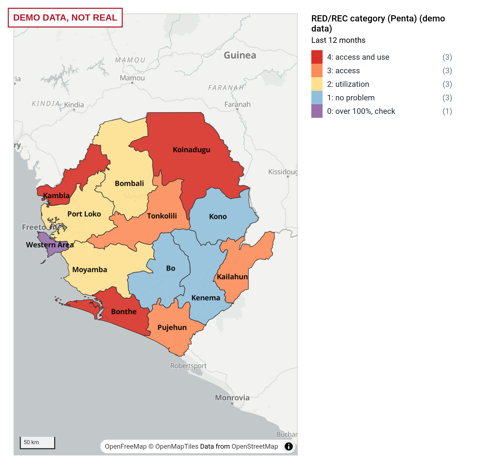
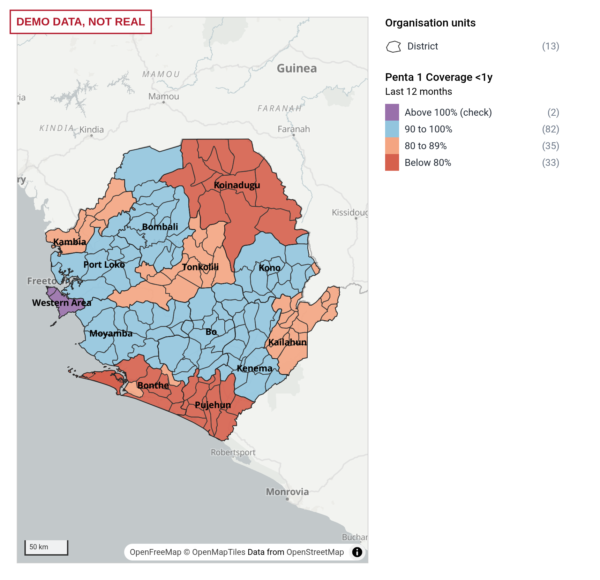
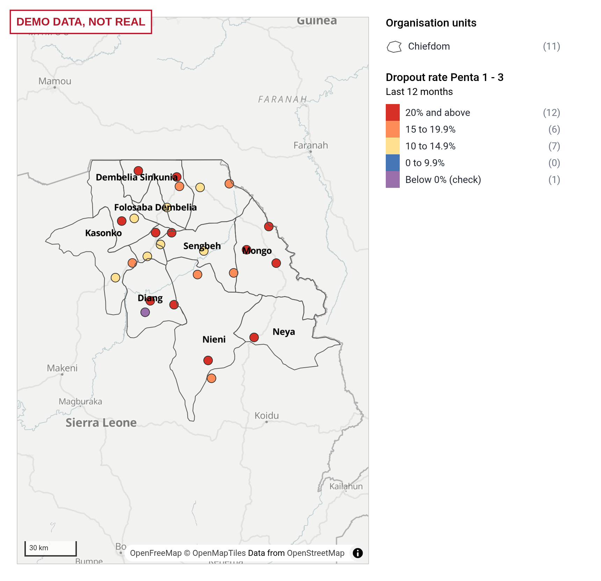

# Post 1 · Where are the unvaccinated? Access vs. utilization on the map

**At a glance.** Immunization (EPI) · Thematic layers with legend sets and labels at district, chiefdom and facility level, drill down, Open in Data Visualizer app, interpretations · Aggregate data · For EPI managers

**Hook.** A district with low coverage needs new sessions; a district with high dropout needs defaulter tracing. One thematic layer that combines Penta1 coverage and dropout tells the EPI manager which problem each district has, and two close-ups show where inside the district it sits.

**The map.** The maps go from the RED/REC category of each district, to coverage by chiefdom, to the facilities of one category 4 district where tracing starts.

**Map 1 · Where are the unvaccinated?**

*DEMO DATA, NOT REAL.* RED/REC category by district, last 12 months. [Open the map](https://play.im.dhis2.org/dev-2-43/dhis-web-maps/index.html#/dRuP9fTIT2X)

**Map 2 · Penta1 coverage by chiefdom**

*DEMO DATA, NOT REAL.* Penta1 coverage under 1 by chiefdom, last 12 months. [Open the map](https://play.im.dhis2.org/dev-2-43/dhis-web-maps/index.html#/xb1gQdtAAb9)

**Map 3 · Dropout by facility in Koinadugu**

*DEMO DATA, NOT REAL.* Penta1 to Penta3 dropout by facility, last 12 months. [Open the map](https://play.im.dhis2.org/dev-2-43/dhis-web-maps/index.html#/r9DBeXIcuVP)

Map 1 is a thematic layer of the indicator "RED/REC category (Penta) (demo data)" by district, last 12 months, with the legend set "Showcase: RED/REC category" and district names as labels. Map 2 is a thematic layer of Penta1 coverage by chiefdom under district boundaries; its legend keeps 80% as a second break. Map 3 shows Koinadugu's facilities coloured by dropout. The data is invented; the facility names are real.

**How to read it.** On Map 1, the colour places each district in a RED/REC category, from its Penta1 coverage (access) and its dropout (utilization).

| Category | Colour on Map 1 | Penta1 coverage | Dropout | Problem | Typical response |
| --- | --- | --- | --- | --- | --- |
| 1 | Light blue | 90% or more | under 10% | None | Sustain, look for pockets inside the district |
| 2 | Pale yellow | 90% or more | 10% or more | Utilization | Defaulter tracing, reminders, reliable session schedules |
| 3 | Orange | under 90% | under 10% | Access | Outreach, new fixed or mobile sessions, microplan review |
| 4 | Red | under 90% | 10% or more | Both | Priority for supervision and resources |

Two patterns are data flags, not performance, and the maps show both in purple. Coverage above 100% usually means the target population is too low: Western Area is purple on Maps 1 and 2. A negative dropout means more Penta3 than Penta1 doses were recorded, which points to recording errors or children vaccinated outside their catchment: one Koinadugu facility is purple on Map 3, where the red facilities, at 20% dropout or more, are where tracing starts.

**In the workflow.** Before the monthly review meeting, the district EPI officer opens the maps from the immunization **dashboard**. Right-clicking a red district and choosing **Drill down one level** shows its chiefdoms. **Open in Data Visualizer app** on the dropout layer turns the data into a monthly trend, which separates a one-off dip from a steady slide. The officer writes an **interpretation** naming the facilities and @mentioning their in-charges; on the demo it reads "Koinadugu is in RED/REC category 4: Penta1 coverage 72% and dropout 19% over the last 12 months." The agreed fix goes into the microplan. The [Immunization Analysis app](https://docs.dhis2.org/en/use/optional-apps/immunization-analysis-app/app-version-103/immunization-analysis-app-user-manual.html) adds coverage and dropout tables by district and facility.

**Domain note.** Children with no DTP1 dose (zero-dose children) reflect a lack of access, and DTP1-to-DTP3 dropout reflects under-use of services by children who did have access ([CDC MMWR, 2020](https://WWW.CDC.GOV/mmwr/volumes/70/wr/mm7043a1.htm)). The cut-offs above (90% coverage, 10% dropout) are the ones used in the categorization visualization of the [DHIS2 EPI aggregate package](https://docs.dhis2.org/ar/implement/health/immunization/expanded-programme-on-immunization-epi-aggregate/design.html); older AFRO RED guidance used 80% for district coverage, so state which cut-off your country uses. Zero-dose strategies also rank areas by number: a large district at 85% coverage can hold more zero-dose children than a small one at 60%, so add "Children who missed Penta1 (demo data)" as a bubble layer when ranking category 3 and 4 districts.

**In practice.** Uganda's EPI runs this categorization on DHIS2 data every year. Its 2024 to 2025 Gavi joint appraisal shows the RED/REC maps, with more districts moving into Category 1 as the number of vaccinating health facilities grew from 4,313 in 2024 to 4,563 in 2025 ([Gavi joint appraisal](https://www.gavi.org/news/document-library/uganda-joint-appraisal-2024-2025)).

**Try it.** On the demo, open [Map 1](https://play.im.dhis2.org/dev-2-43/dhis-web-maps/index.html#/dRuP9fTIT2X) and choose **Show data table** in the layer's menu. On your instance (v43):

1. In the Metadata Management app, which replaces the Maintenance app in v43, create the legend sets: category (0 to 4), coverage (80, 90, 100%), dropout (0, 10, 15, 20%).
2. Create the category indicator `if(C > 1, 0, if(C >= 0.9, if(D < 0.1, 1, 2), if(D < 0.1, 3, 4)))`, with C = Penta1 doses ÷ surviving infants and D = (Penta1 − Penta3) ÷ Penta1.
3. If your instance has no dropout indicator, build one as a custom calculation in the Maps data item selector.
4. Add layer → Thematic → the category indicator → Period: Last 12 months → Org Units: District level → Style: Predefined color legend, labels on.
5. Build Map 2 at Chiefdom level and Map 3 at Facility level for one district the same way, each with an Org units layer for boundaries.
6. File → Save, share with your EPI user group, and add the maps to the immunization dashboard.

**Your turn.** Which cut-offs does your national EPI use, and do you categorize districts, facilities or both? Share a screenshot of your RED/REC map (demo or anonymised data) with your versions, and the limits you hit, such as denominators you don't trust.

---

[Post 2 · Rain today, malaria next month →](02-rain-malaria.md)
