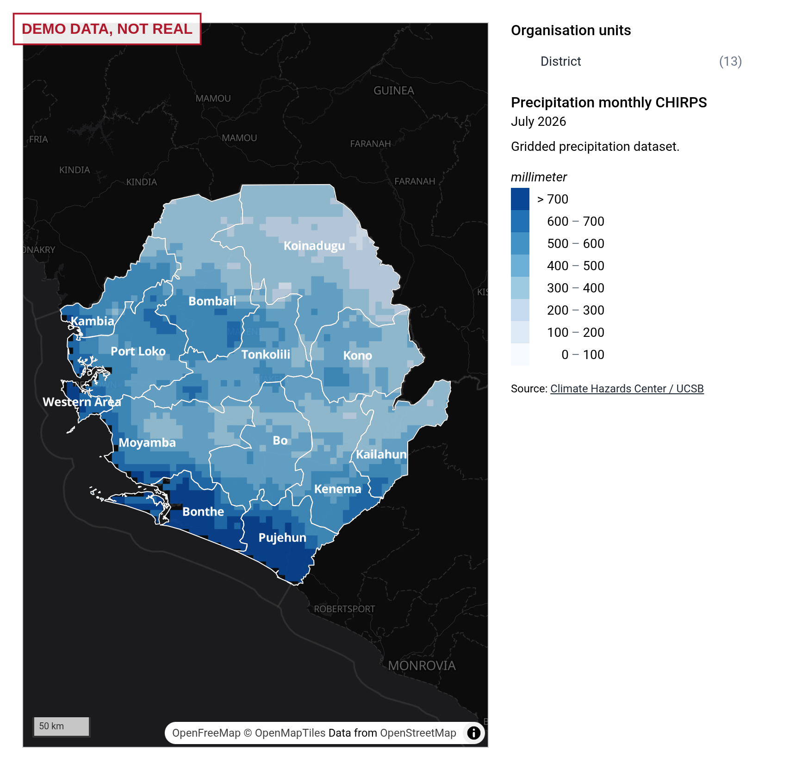
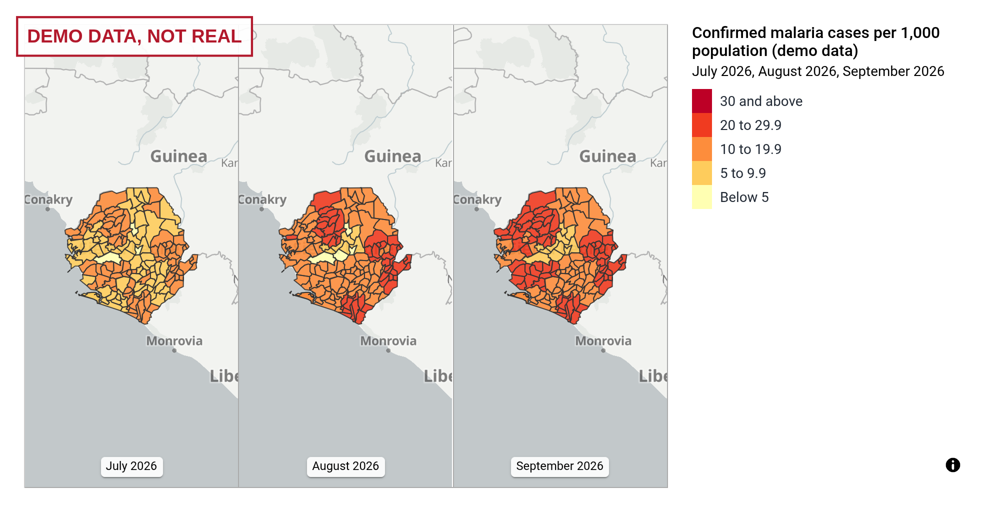
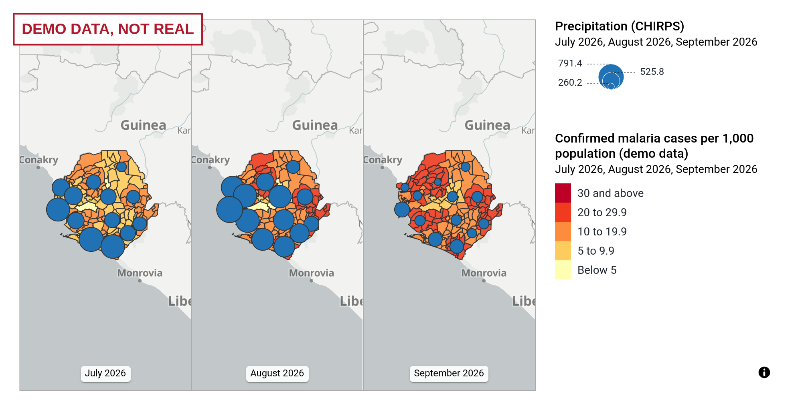

# Post 2 · Rain today, malaria next month: climate layers next to case data

**At a glance.** Malaria, climate and health · Earth Engine climate layers, split view with synced periods, data table, Download data · Aggregate and climate data · For malaria programmes and climate focal points

**Hook.** Malaria cases in most of Africa follow rainfall by one to three months. The Maps app now puts satellite rainfall and temperature next to your HMIS data, aggregated to the same districts.

**The map.** Map 1 shows where it rained in July, Map 2 how cases followed over the next months, and Map 3 puts rain and cases on the same monthly panels.

**Map 1 · Rain, July 2026**

*DEMO DATA, NOT REAL.* CHIRPS rainfall by district, July 2026, real satellite data. [Open the map](https://play.im.dhis2.org/dev-2-43/dhis-web-maps/index.html#/NVJGcABEddB)

**Map 2 · Malaria cases, July to September**

*DEMO DATA, NOT REAL.* Confirmed cases per 1,000 by chiefdom, July to September 2026. [Open the map](https://play.im.dhis2.org/dev-2-43/dhis-web-maps/index.html#/cNNHvte3K7r)

**Map 3 · Rain and malaria cases**

*DEMO DATA, NOT REAL.* Cases by chiefdom, rainfall by district, July to September 2026. [Open the map](https://play.im.dhis2.org/dev-2-43/dhis-web-maps/index.html#/R67K4vBGFsa)

Map 1 is an Earth Engine layer, Precipitation monthly CHIRPS for July 2026, with district means in pop-ups and the data table, and a hidden Temperature monthly layer. Earth Engine layers can't join a split view, so Map 2 is a separate thematic layer of confirmed cases per 1,000 by chiefdom, split by month. Map 3 adds the CHIRPS rainfall imported with the Climate app as district bubbles, a second split layer with synced periods ([DHIS2 v43 overview](https://dhis2.org/releases/version-43/)). The January 2026 Maps app release added these climate sources ([release announcement](https://community.dhis2.org/t/maps-app-v105-5-is-now-available-new-climate-layer-sources/69377)).

The rainfall is real; the cases are invented from each district's rain one and two months earlier, and Tonkolili's dry-season peak is planted. A split map downloads as narrow panels, so attach Map 1 to reports.

**How to read it.** Districts that turn dark blue on Map 1 and turn red one or two panels later behave as expected for climate-driven transmission. Districts that darken without heavy rain deserve a closer look: irrigation, dams, population movement, an intervention gap, or a change in testing. Tonkolili stays pale through the rains; its cases peaked in April, in the dry season.

Temperature explains other exceptions. Transmission is limited to roughly 16 to 34 °C and peaks near 25 °C, so cool highlands can stay low after heavy rain ([Parasites & Vectors, 2019](https://link.springer.com/10.1186/s13071-019-3547-z)). Very heavy rain can also flush breeding sites and reduce transmission.

**In the workflow.** Two to three months before the usual peak, the malaria programme reviews the maps with the meteorological agency, sorting districts by rain in the **data table**. Districts with heavy early rain and a history of cases one to two months later move up the list for net distribution, seasonal chemoprevention and pre-positioned stock (Post 8). **Download data** on the cases layer exports monthly values as GeoJSON for the modelling team. An **interpretation** on Map 3 asks whether irrigation explains Tonkolili before the chemoprevention calendar changes.

**Domain note.** In a 10-year Kenyan series, rainfall two months earlier increased malaria cases across all four ecological zones, while temperature effects acted at 0 to 1 month lags ([Baringo County study, 2004 to 2014](https://pmc.ncbi.nlm.nih.gov/articles/PMC5445289)). A map shows co-occurrence, not cause: nets, spraying and chemoprevention shape the same pattern. Use confirmed cases or test positivity, and check reporting completeness first.

CHIRPS has a resolution of about 5 km and ERA5-Land about 9 km ([Climate App guide](https://docs.dhis2.org/pt/implement/climate-health/climate-app-user-guide.html)), so compare rain by district, as Map 3 does. A plain mean weights empty forest like towns; [population-weighted aggregation](https://climate-tools.dhis2.org/guides/aggregation/population-weighting/) in DHIS2 Climate Tools weights pixels by where people live. The guide [Using climate data for malaria program planning](https://docs.dhis2.org/en/implement/climate-health/using-climate-data-for-malaria-program-planning.html) walks through the full workflow.

**In practice.** Uganda has installed the Climate App in its national HMIS and malaria repository, with 10 years of imported ERA5 and NASA data ([Uganda profile](https://dhis2.org/climate/country-profiles/uganda/)), and produces real-time malaria risk maps in DHIS2 alongside heat stress and air quality layers ([DHIS2 Community, Uganda story](https://community.dhis2.org/t/using-dhis2-to-link-climate-air-quality-and-health-outcomes-in-uganda-a-story-of-innovation-and-collaboration/65180)). Togo built a Climate Peak App that finds the peak rainfall months for each district ([Togo profile](https://dhis2.org/climate/country-profiles/togo/)), and Mozambique has deployed the CHAP modelling platform nationally with automated malaria alerts to district offices ([Climate & Health at DAC2026](https://community.dhis2.org/t/dac2026-summary-wiki-ai-climate-health/75799)).

**Try it.** On the demo, open [Map 1](https://play.im.dhis2.org/dev-2-43/dhis-web-maps/index.html#/NVJGcABEddB) and switch on temperature. On your instance (v43):

1. Configure a Google Earth Engine key, and have a Maps app administrator enable Precipitation monthly CHIRPS and Temperature monthly.
2. Import monthly CHIRPS rainfall by district with the Climate app.
3. Add layer → Earth Engine → Precipitation monthly CHIRPS → Period: the peak rainfall month → Org Units: District level.
4. New map: Add layer → Thematic → confirmed cases per 1,000 → Period: the rainfall month and the two after it, Split → Org Units: Chiefdom level → Style: Predefined color legend.
5. On a copy: Add layer → Thematic → the imported rainfall → same periods, Split → District level → Bubble map.
6. File → Save each map and add them to the malaria dashboard.

**Your turn.** What lag between rainfall and cases do you see in your districts? Share your climate and case maps with your Maps app version, and what got in the way, such as Earth Engine access or period types that don't line up.

**En bref.** Les cartes montrent les pluies CHIRPS de juillet 2026 puis les cas de paludisme de juillet à septembre, en vue partagée. Les cas suivent la pluie avec un ou deux mois de décalage, sauf à Tonkolili, où la démonstration place un pic en saison sèche ; les pluies sont réelles, les cas inventés. L'Ouganda a installé l'application Climat dans son HMIS, et le Togo repère avec DHIS2 les mois de pic de pluie de chaque district.

---

[← Post 1 · Where are the unvaccinated?](01-unvaccinated.md) · [Post 3 · Drawing the ring around cholera →](03-cholera-rings.md)
