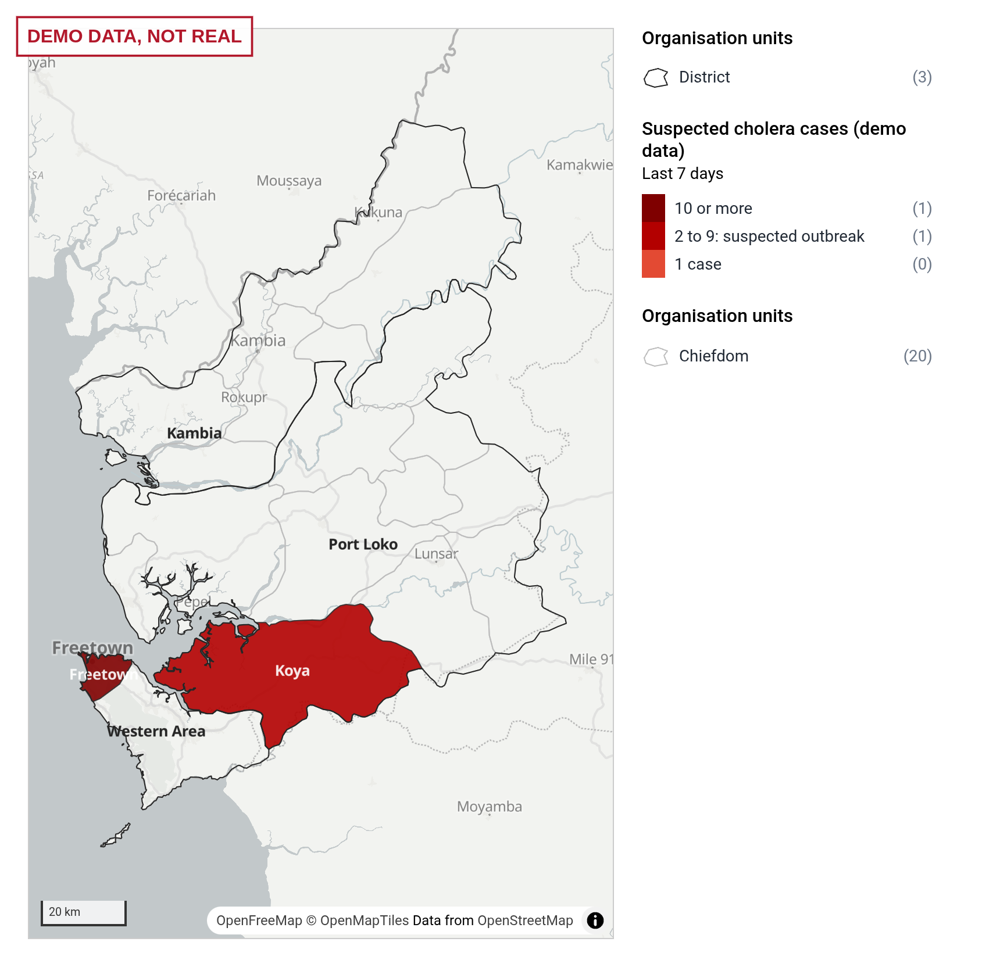
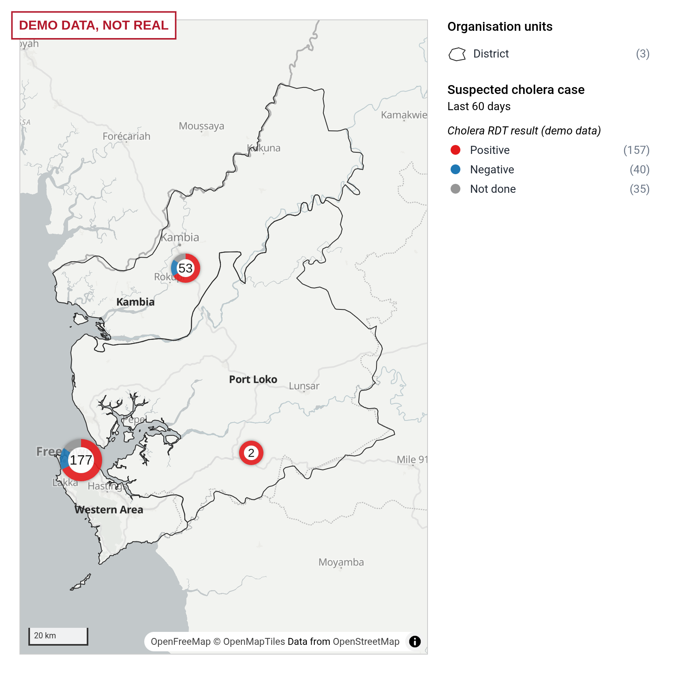
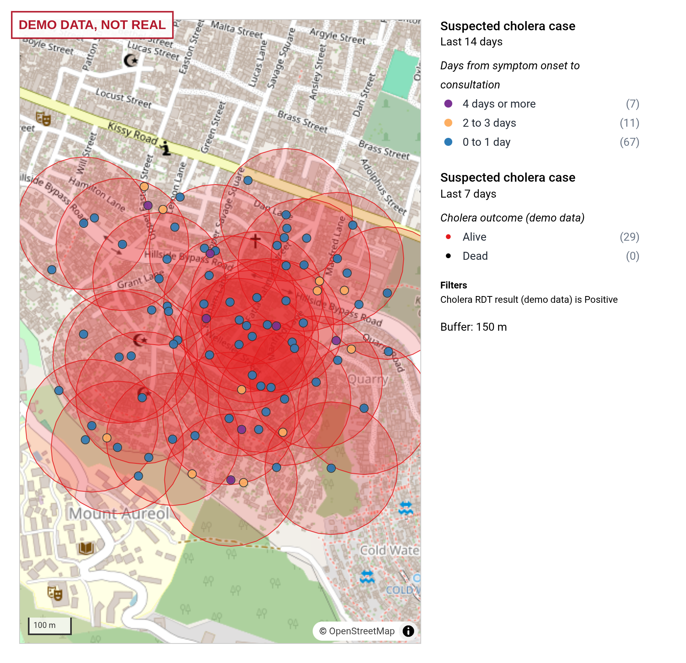

# Post 3 · Drawing the ring around cholera: event layers with buffers

**At a glance.** Outbreak response (cholera) · Thematic layer from a program indicator, event layers with group events, style by data item and buffers, Download data, Download map · Case-based data · For surveillance and WASH response teams

**Hook.** Case-area targeted interventions send a response team to the households around each new cholera case within days. The event layer turns a case line list into those rings, ready to hand to a field team.

**The map.** The maps go from suspected outbreaks by chiefdom, to case groups over two months, to rings in the busiest cluster's streets.

**Map 1 · Suspected cases by chiefdom**

*DEMO DATA, NOT REAL.* Suspected cholera cases by chiefdom, last 7 days. [Open the map](https://play.im.dhis2.org/dev-2-43/dhis-web-maps/index.html#/O5cSxQIy8ZH)

**Map 2 · Cases grouped, 60 days**

*DEMO DATA, NOT REAL.* Suspected cases by RDT result, last 60 days. [Open the map](https://play.im.dhis2.org/dev-2-43/dhis-web-maps/index.html#/dWmysLTDJkQ)

**Map 3 · Drawing the ring**

*DEMO DATA, NOT REAL.* Freetown cases and 150 m rings, last 14 days. [Open the map](https://play.im.dhis2.org/dev-2-43/dhis-web-maps/index.html#/xe58DQMBFNU)

Map 1 is a thematic layer of the program indicator "Suspected cholera cases (demo data)" by chiefdom in Western Area, Port Loko and Kambia, last 7 days. It shows counts, not rates, because two or more suspected cases, or one RDT-positive case, in a unit within 7 days meets the GTFCC definition of a suspected outbreak ([GTFCC surveillance course, 2025](https://www.gtfcc.org/wp-content/uploads/2025/03/gtfcc-cholera-surveillance-for-health-care-authorities-module-2-slides-en.pdf)); cases without household coordinates still count. Map 2 is an event layer, last 60 days, with group events styled by RDT result: red positive, blue negative, grey not done. Map 3 has two event layers in Freetown: RDT-positive cases of the last 7 days with a 150 m buffer, and cases of the last 14 days styled by days from symptom onset to consultation.

The cases are invented and placed at random in a real Freetown neighbourhood, so some fall on roads. Event layer legends show the program stage name, so both legends of Map 3 read "Suspected cholera case".

**How to read it.** Each ring on Map 3 is a work order: households inside it get the response package. Overlapping rings, as in Freetown, mark a cluster that may need a village-level response. Purple points came four days or more after onset: care or awareness lags there.

A case with no recent neighbours is a new focus and the highest priority: Koya is red on Map 1 with two cases and nothing earlier on Map 2. Kambia's group of 53 on Map 2 has no colour on Map 1: that wave has stopped. A red chiefdom without points has cases without household coordinates (92 of 329 in the demo): start from the facility line list.

**In the workflow.** At the morning incident management meeting, the surveillance lead opens the maps from the cholera response **dashboard** and clicks cases to check their RDT result and onset. **Download data** on the rings layer exports today's cases as GeoJSON for the teams' offline navigation apps, and **Download map** saves a PNG for the situation report. The **interpretation** on Map 3 makes Koya "today's first team" and @mentions the tracing supervisor. Tomorrow's map shows what was reached.

**Domain note.** CATI delivers interventions to households in a 100 to 250 m ring around the case household, and analyses of outbreak data support a high-risk zone of that size lasting about 7 days ([BMJ Open protocol, 2022](https://pmc.ncbi.nlm.nih.gov/articles/PMC9260795)). Packages combine hygiene promotion, water treatment, case-finding, oral cholera vaccine and, where policy allows, chemoprophylaxis for close contacts. In Kribi, Cameroon, teams reached case areas a mean of 3.4 days after detection ([Bulletin of the WHO, 2023](https://pmc.ncbi.nlm.nih.gov/articles/PMC9948504)), so the 7-day filter matches the useful window.

The radius is an operational choice. Two NGOs used 150 m rings in northeast Nigeria in 2021 ([GTFCC WASH working group, 2022](https://www.gtfcc.org/wp-content/uploads/2022/01/7th-meeting-of-the-gtfcc-working-group-on-wash-2022-day-1-lantagne-handzel-kaur-ratnayake.pdf)), and teams there departed from their procedures because of incomplete line lists and high density ([Johns Hopkins implementation study](https://hopkinshumanitarianhealth.org/research/publications/implementation-considerations-in-case-area-targeted-interventions-to-preven)). The Earth Engine Building footprints layer shows how many structures a ring would hold. Rings need household coordinates, so fix the capture form if every case sits on its facility. Household points are personal data: share the map only with the response team.

**In practice.** Zambia's DHIS2-based e-IDSR has a cholera case tracker that captures the patient's GPS location, offline on Android. In the 2023 to 2024 outbreak it recorded more than 33,980 cases, but only about 30% had GPS coordinates ([JIEPH conference abstract, 2025](https://afenet-journal.org/enhancing-disease-surveillance-zambias-cholera-tracker-2019-to-2024/)). DHIS2 runs case-based surveillance of notifiable diseases in more than 30 countries ([DHIS2 disease surveillance](https://dhis2.org/disease-surveillance/)), so the same layers work wherever a cholera line list lives in Tracker.

**Try it.** On the demo, open [Map 3](https://play.im.dhis2.org/dev-2-43/dhis-web-maps/index.html#/xe58DQMBFNU), click a case, and choose **Download data** in the rings layer's menu. On your instance:

1. Build the case program from the GTFCC template case report form ([GTFCC surveillance resources](https://www.gtfcc.org/?p=669)) and capture the household location as the event's coordinate.
2. Create a program indicator that counts case reports, and a legend set with 1, 2 to 9 and 10 or more.
3. Add layer → Thematic → the program indicator → Period: Last 7 days → Org Units: Chiefdom level → Style: Predefined color legend.
4. New map: Add layer → Events → program and stage → Period: Last 60 days → Style: Group events, Style by data item: RDT result.
5. New map: Add layer → Events → Filter: RDT result is Positive → Period: Last 7 days → Style: Buffer 150 m.
6. File → Save each map and share it only with the response team's user group.

**Your turn.** What ring radius does your country use, and how do teams get household coordinates during an outbreak? Share your map (demo or anonymised data only) and where it broke down, such as missing GPS.

---

[← Post 2 · Rain today, malaria next month](02-rain-malaria.md) · [Post 4 · Who hasn't been seen today? →](04-contact-follow-up.md)
