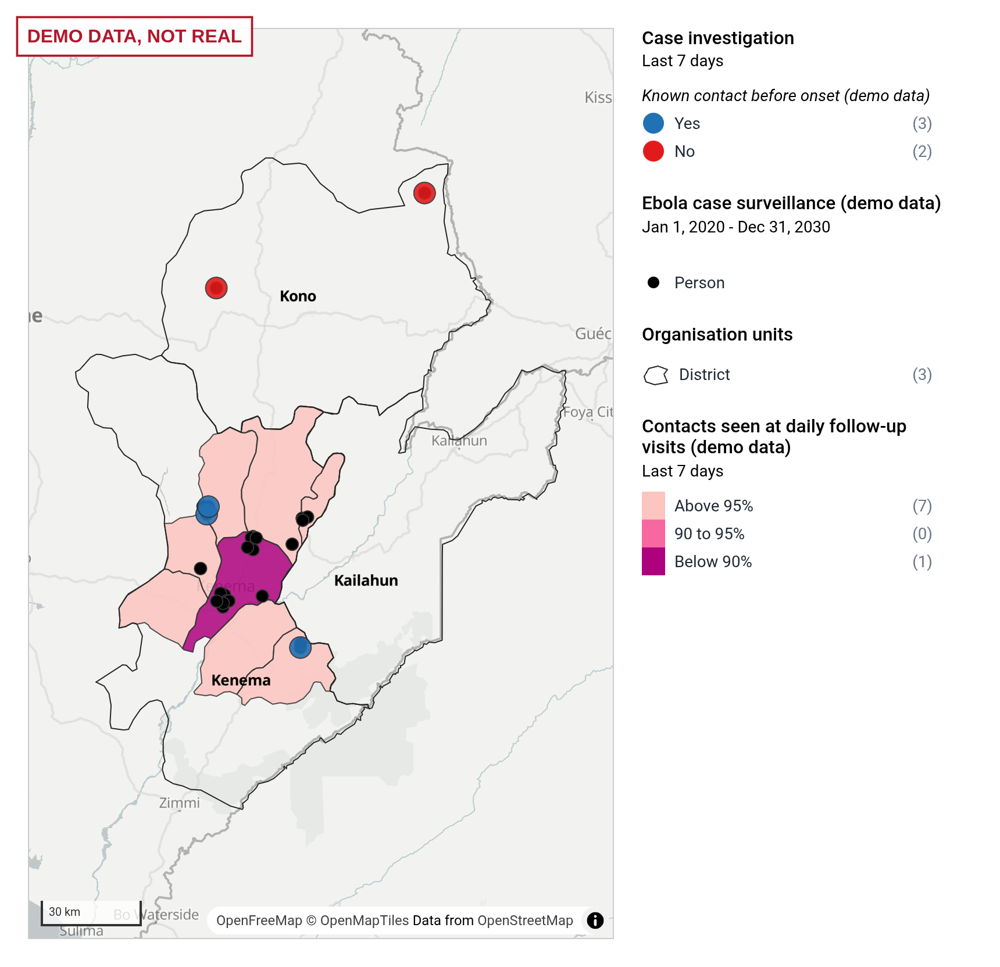
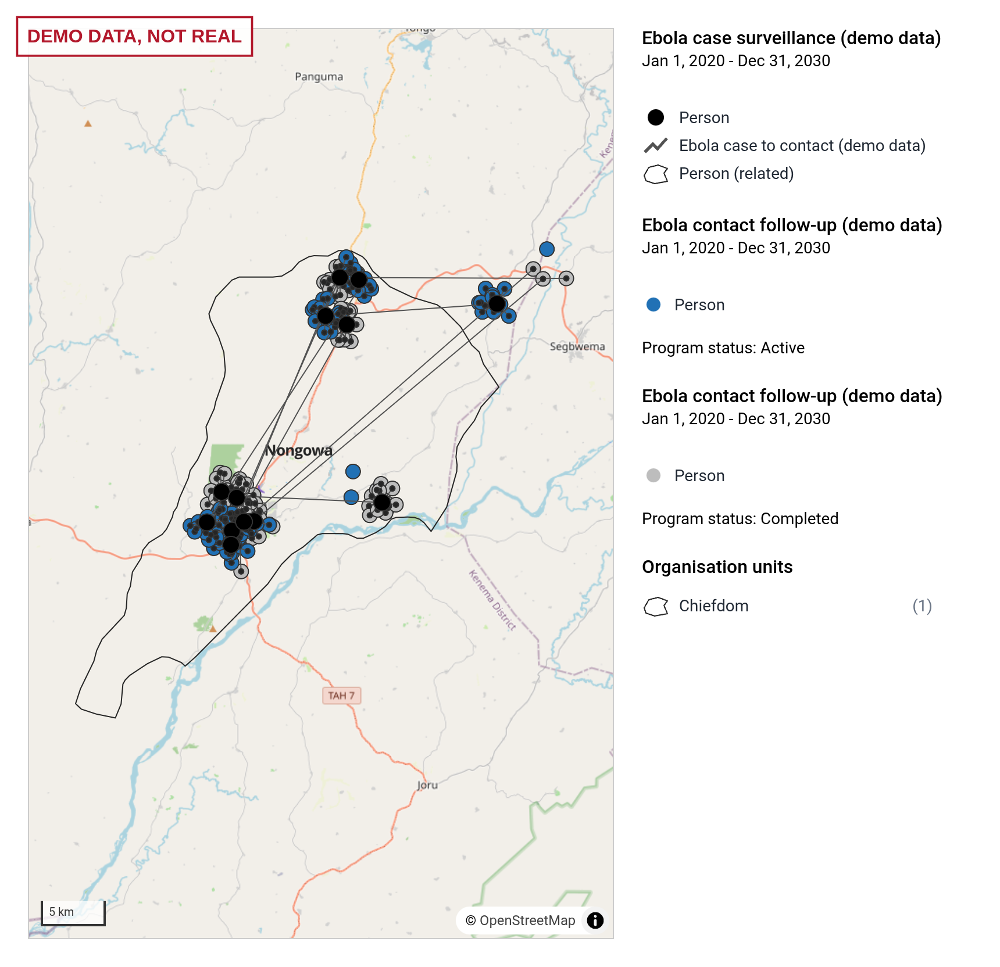

# Post 4 · Who hasn't been seen today? Outbreak contact follow-up on the map

**At a glance.** Outbreak contact tracing · Tracked entity layers by program status, relationship lines across two programs, event layer styled by data item, indicator choropleth, data table, sharing · Tracker data · For contact tracing supervisors and incident managers

**Hook.** Three numbers tell an Ebola response whether contact tracing works: how many contacts each case has, how many were seen at their daily visit, and how many new cases were already on a contact list. The Maps app shows where the last two are failing, down to the contacts a team must visit today.

**The map.** The maps go from the outbreak area, where one chiefdom misses its contacts, to that chiefdom's cases and contacts linked by lines.

**Map 1 · Who hasn't been seen today?**

*DEMO DATA, NOT REAL.* Contacts seen, cases and new cases, last 7 days. [Open the map](https://play.im.dhis2.org/dev-2-43/dhis-web-maps/index.html#/S4j9zKyue60)

**Map 2 · Contacts to visit in Nongowa**

*DEMO DATA, NOT REAL.* Nongowa cases linked to contacts, by follow-up status. [Open the map](https://play.im.dhis2.org/dev-2-43/dhis-web-maps/index.html#/PDopqF1wGjt)

Map 1 is a thematic layer of "Contacts seen at daily follow-up visits (demo data)", the share of daily visits that found the contact, by chiefdom in Kenema, Kailahun and Kono, last 7 days. On top sit a tracked entity layer of cases (black) and an event layer of new cases, styled by "Known contact before onset": blue yes, red no. Map 2 has tracked entity layers of contacts, completed (grey) and active (blue), under cases with the relationship type "Ebola case to contact (demo data)" drawn as lines.

Cases and contacts sit in two programs, the standard DHIS2 design, and the Maps app on the demo (101.18.0) draws the lines between them, an experimental feature that also works within one program. The legend names each tracked entity layer by its program, not the layer name. The outbreak is invented, placed in Kenema and Kailahun, the real epicentres of Sierra Leone's 2014 to 2015 epidemic.

**How to read it.** On Map 1, Nongowa is dark magenta: 78% of daily visits found the contact, against more than 95% in the 7 other chiefdoms. It needs tracers or transport. A blue new case was a known contact, which is what success looks like; the two red cases in Kono came from outside known chains and are the priority for investigation and active case finding.

On Map 2, blue contacts are still within their 21 days and need today's visit; grey ones have finished. Long lines lead to contacts living away from their index case, whose local team needs the hand-over.

**In the workflow.** At the morning incident management meeting, the surveillance lead opens both maps from the outbreak **dashboard**. The **data table** on the contacts-seen layer, sorted by value, lists the chiefdoms that need extra tracers today. The tracing supervisor's **interpretation** asks for "two more tracers and a motorbike today" in Nongowa and @mentions the surveillance lead to send an investigation team to the two Kono cases. The maps are **shared** only with the response team's user group, because contact locations are sensitive. The [Relationship Tracing app](https://community.dhis2.org/t/dhis2-relationship-tracing-app/39217) adds a network view of transmission chains.

**Domain note.** In its report on the 2026 Bundibugyo Ebola outbreak in the DRC, CDC lists response targets of at least 20 contacts identified per case, daily contact follow-up above 95%, and more than 90% of new cases coming from known contacts; at the time, only 15 to 20% of new cases were known contacts ([CDC MMWR, 2026](https://www.cdc.gov/mmwr/volumes/75/wr/pdfs/mm7535e1-H.pdf)). Contacts are followed for 21 days after their last exposure ([WHO Ebola Q&A](https://www.who.int/news-room/q-a-detail/ebola-virus-disease)). For tuberculosis, household contacts share the index case's location and sit in a separate program ([DHIS2 TB Household Contact Investigation design](https://docs.dhis2.org/en/implement/health/tuberculosis/tb-household-contacts-investigation/design.html)), so map the aggregate household-contact indicators instead.

**In practice.** DHIS2 was at the centre of the DRC's 2025 Ebola response: health workers followed up nearly 600 contacts, and the command centre could see which contacts had not yet been visited and send teams to close the gaps ([DHIS2 impact story](https://dhis2.org/?p=24229)). HISP groups support the current Ebola response in the DRC and Uganda, and HISP UiO works with Africa CDC on a standardized surveillance toolkit ([DHIS2 In Action](https://dhis2.org/in-action/)). DHIS2's surveillance design describes this view: maps of contacts per case, completeness of follow-up and contacts who become cases ([DHIS2 disease surveillance](https://dhis2.org/disease-surveillance/)). Uganda's 2022 Ebola situation reports showed 94% follow-up overall, with districts from 93% to 100% ([WHO AFRO sitrep 19](https://www.afro.who.int/sites/default/files/2022-10/19%20EVD_SitRep%2319_221009_191718.pdf)), exactly the variation the choropleth shows. Contacts face stigma: restrict the maps to the response team, and use demo data publicly.

**Try it.** On the demo, open [Map 2](https://play.im.dhis2.org/dev-2-43/dhis-web-maps/index.html#/PDopqF1wGjt), click a contact, and open **Edit layer** → Relationships on "Cases and their contacts". On your instance:

1. Prerequisites: case and contact programs linked by a relationship type, registration that captures each person's coordinate, a follow-up indicator from two program indicators (visits where seen ÷ all visits), and a legend set at 90 and 95%.
2. Add layer → Thematic → the follow-up indicator → Period: Last 7 days → Org Units: Chiefdom level → Style: Predefined color legend.
3. Add layer → Events → case program and stage → Period: Last 7 days → Style by data item: known contact.
4. New map: Add layer → Tracked entities → contact program → Program status: Completed. Duplicate layer → Program status: Active.
5. Add layer → Tracked entities → case program → Relationships: Display Tracked Entity relationships, your relationship type.
6. File → Save each map and share it only with the response team's user group.

**Your turn.** How do you see which contacts were missed today: a map, a line list or a phone call? Share a demo-data screenshot with your versions, and the limits you met, such as contacts without coordinates.

---

[← Post 3 · Drawing the ring around cholera](03-cholera-rings.md) · [Post 5 · Two hours to emergency care →](05-emergency-obstetric-care.md)
