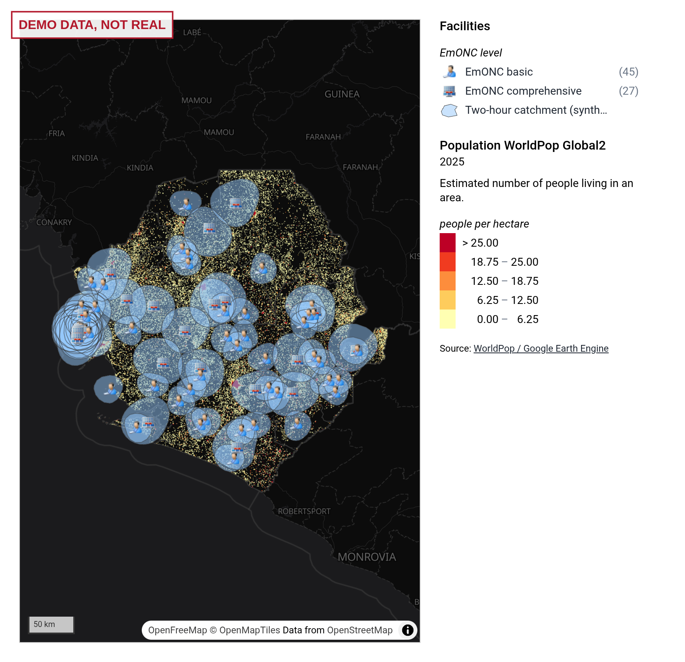
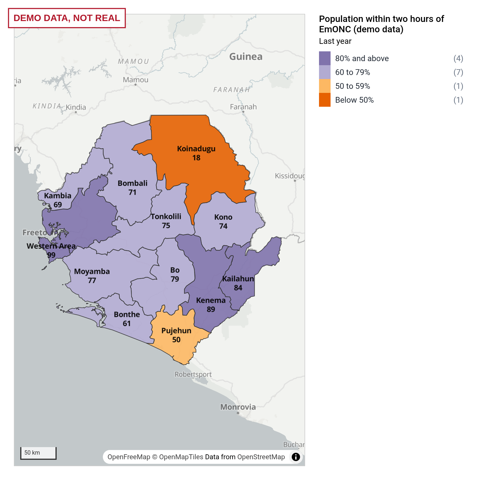
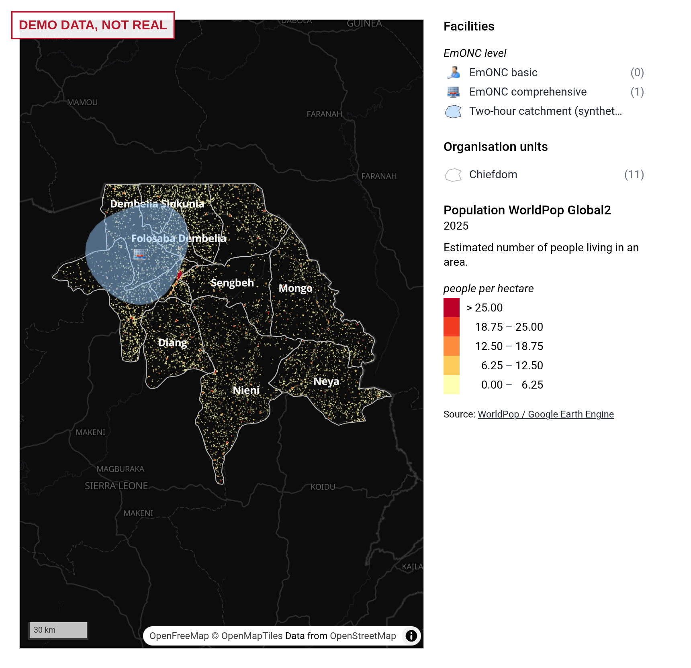

# Post 5 · Two hours to emergency care: mapping access to emergency obstetric care

**At a glance.** Maternal and newborn health · Facility layer with associated geometry (two-hour catchments), Earth Engine population (WorldPop Global2), org unit profile, interpretations, Download map · Aggregate and population data · For reproductive health planners

**Hook.** About 15% of pregnant women develop a complication that needs emergency care ([WHO, UNFPA, UNICEF and AMDD handbook, 2009](https://www.who.int/publications/i/item/9789241547734)), and the nearest facility that can treat it decides whether they survive. Facility catchments over a population layer show who lives more than two hours away.

**The map.** Map 1 shows where people live against every EmONC catchment, Map 2 each district's share within two hours, and Map 3 closes in on Koinadugu, the district furthest from care.

**Map 1 · Two hours to EmONC**

*DEMO DATA, NOT REAL.* WorldPop population and EmONC catchments, 2025. [Open the map](https://play.im.dhis2.org/dev-2-43/dhis-web-maps/index.html#/Tcznh8e8pWI)

**Map 2 · Share within two hours**

*DEMO DATA, NOT REAL.* Share of each district within two hours, 2025. [Open the map](https://play.im.dhis2.org/dev-2-43/dhis-web-maps/index.html#/YzbetkLy4hC)

**Map 3 · Beyond two hours in Koinadugu**

*DEMO DATA, NOT REAL.* Koinadugu's population, chiefdoms and its one catchment. [Open the map](https://play.im.dhis2.org/dev-2-43/dhis-web-maps/index.html#/ZHQslRWhweG)

Map 1 is an Earth Engine layer, Population WorldPop Global2 2025, under a facility layer styled by the "EmONC level" group set: 27 comprehensive facilities (hospital icon) and 45 basic (person icon), each with its catchment through **Use associated geometry**. Map 2 is a thematic layer of the population share inside a catchment, last year, by district. Map 3 repeats Map 1 for Koinadugu, with its chiefdoms.

The population is real WorldPop data; the catchments, and so the shares, are invented, about 25 km around comprehensive and 15 km around basic facilities. Koinadugu has no hospital in the demo database, so a health centre, Bafodia CHC, stands in as its only EmONC facility.

**How to read it.** Yellow and red pixels outside every blue catchment are women who cannot reach emergency obstetric care within two hours: candidates for an upgraded health centre, a maternity waiting home or referral transport. Catchments share one colour whatever the level, so Map 1 doesn't show who can reach a caesarean section.

On Map 2, districts below 50% (dark orange) are the national priority: Koinadugu at 18%. A district above 60% can still hide uncovered pockets, which Map 1 shows. On Map 3, Bafodia CHC's catchment stops just short of Kabala, the red patch of the district's main town.

**In the workflow.** During annual planning, the reproductive health team uses these maps to choose which health centres to upgrade and where to station ambulances. **View profile** on a facility opens its **org unit profile**, which can show staffing and signal-function data where configured. The team saves the maps with **Download map** for the plan and records the reasoning in an **interpretation**: on the demo, the planner shortlists two Koinadugu health centres and a maternity waiting home.

**Domain note.** The 2009 WHO/UNFPA/UNICEF/AMDD handbook sets a minimum of five EmONC facilities, including at least one comprehensive, per 500,000 population ([Data for Impact indicator sheet](https://www.data4impactproject.org/prh/womens-health/safe-motherhood/availability-of-functional-emergency-obstetric-and-newborn-care-facilities/)). A basic facility performs all seven basic signal functions in the last three months; a comprehensive one adds caesarean section and blood transfusion. Earlier UNFPA guidance aimed for basic care within 2 hours of travel ([Data for Impact](https://www.data4impactproject.org/?p=5662)). A straight-line buffer ignores rivers, roads and the rainy season, so model travel time in WHO's AccessMod.

The current global benchmark is travel time: the EPMM target is for at least 60% of the population to reach emergency obstetric care within two hours, with 80% of countries above 50% ([WHO, 2021](https://www.who.int/news/item/05-10-2021-new-global-targets-to-prevent-maternal-deaths); [EPMM targets](https://www.alignmnh.org/es/wp-content/uploads/2021/10/EPMM.pdf)). DHIS2 can store a catchment polygon as an extra geometry on each facility through a GeoJSON attribute ([DHIS2 release overview](https://dhis2.org/?p=9389)), and WorldPop Global2 population can be aggregated to those catchments ([WorldPop Global2 announcement](https://community.dhis2.org/t/worldpop-global-2-yearly-high-resolution-population-data-is-now-available-in-dhis2/70851)).

**In practice.** Togo redesigned its EmONC network in 2018 with AccessMod: the 73 prioritised facilities cover 95.5% of the population within two hours, against 96.6% for the earlier 109-facility network ([Togo network study](https://pmc.ncbi.nlm.nih.gov/articles/PMC8327815)); the UNFPA and University of Geneva programme behind the method lists Sierra Leone among its countries ([UNIGE GeoHealth](https://unige.ch/geohealth)). In Siaya County, Kenya, researchers combined DHIS2 data with WorldPop and AccessMod: only 5% of pregnant women could reach a hospital within an hour on foot, 25% with motorcycle transport ([American Journal of GIS, 2020](https://ir.jooust.ac.ke/bitstreams/011c2b3f-16d4-4379-a835-59d02a7faa86/download)). The DHIS2 EmONC toolkit, developed with UNFPA, collects the signal-function data that EmONC groups should follow ([EmONC design guide](https://docs.dhis2.org/en/implement/health/rmncah/emergency-obstetric-and-newborn-care/design.html)).

**Try it.** On the demo instance, open [Map 1](https://play.im.dhis2.org/dev-2-43/dhis-web-maps/index.html#/Tcznh8e8pWI), click a facility to see its EmONC level, and read the interpretation under **Interpretations and details**.

On your own instance (Maps app v101.6.0 or later for WorldPop Global2; saved maps on Global1 need updating by hand):

1. Configure a Google Earth Engine key; a Maps app administrator enables Population WorldPop Global2.
2. Model catchments in [AccessMod](https://www.who.int/tools/accessmod-geographic-access-to-health-care) and load them into a GeoJSON org unit attribute ([DHIS2 2.39 release note](https://docs.dhis2.org/en/implement/software-release-information/dhis2-core-releases/dhis-core-version-239/release-notes.html)).
3. Create the "EmONC level" group set, import AccessMod's population covered per district, and build the share indicator and a legend set (50, 60, 80%).
4. Add layer → Earth Engine → Population WorldPop Global2. Add layer → Facilities → the districts and EmONC groups, Use associated geometry: the catchment attribute → Style by group set. Without catchments, use Buffer, 10 km.
5. New map: Thematic → the share indicator → Last year → District level → Predefined color legend → Labels.
6. Save both maps on a dashboard; start the org unit profile from the [Health Facility Profile package](https://docs.dhis2.org/en/implement/health/health-facility-profile/overview.html).

**Your turn.** Does your country keep EmONC status as an org unit group set? Share an access map (facility-level only), and tell us whether straight-line buffers were good enough or whether you brought AccessMod results back into DHIS2.

---

[← Post 4 · Who hasn't been seen today?](04-contact-follow-up.md) · [Post 6 · Is 100% coverage too good to be true? →](06-mda-denominators.md)
