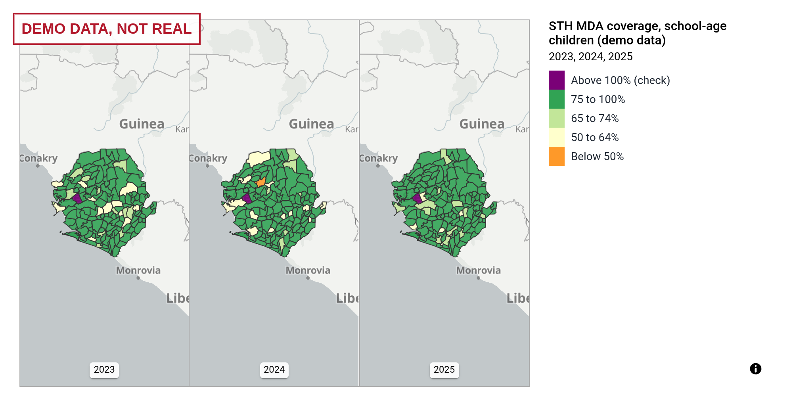
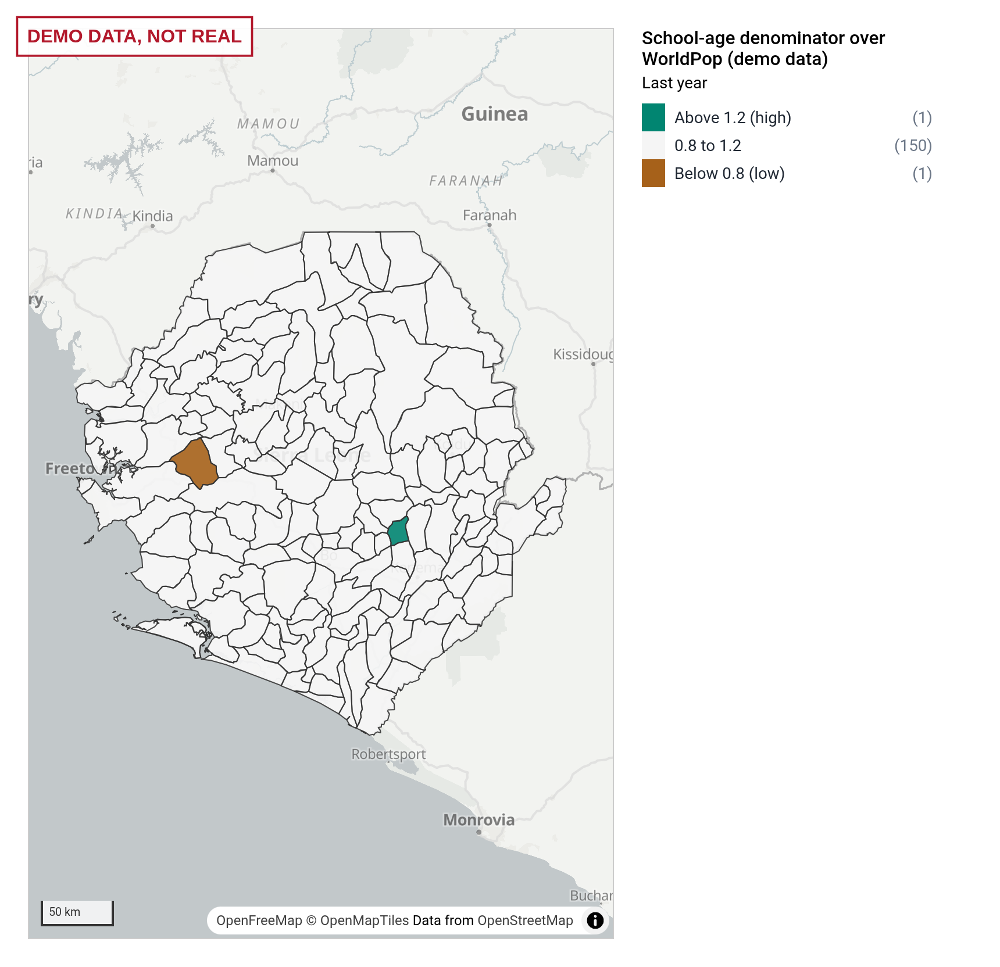
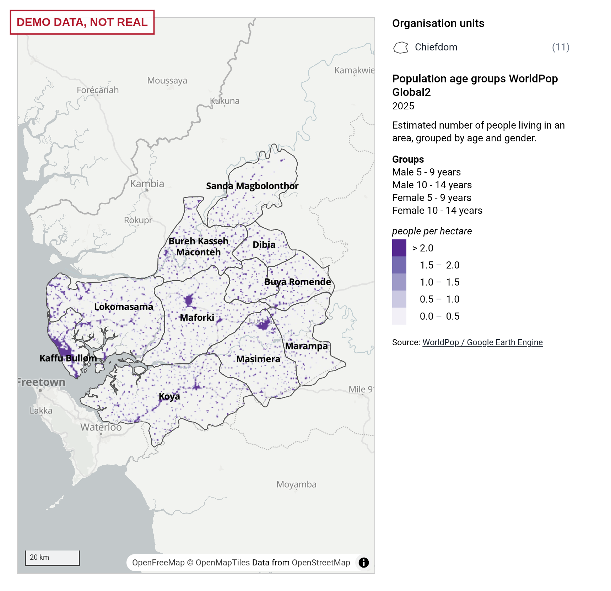

# Post 6 · Is 100% coverage too good to be true? Checking MDA denominators against WorldPop

**At a glance.** Neglected tropical diseases · Split view, Earth Engine population age groups (WorldPop Global2), legend sets with WHO thresholds, data table, Download data · Aggregate and population data · For NTD programme managers

**Hook.** A chiefdom that reports 110% deworming coverage is not over-performing; its denominator is wrong. Split view shows coverage across rounds, and the Earth Engine population age-group layer gives an independent estimate of how many school-age children live there.

**The map.** Map 1 shows coverage over three rounds, Map 2 compares each chiefdom's official school-age estimate with WorldPop, and Map 3 shows where the children of the flagged chiefdom's district live.

**Map 1 · Deworming coverage, three rounds**

*DEMO DATA, NOT REAL.* STH MDA coverage by chiefdom, 2023 to 2025. [Open the map](https://play.im.dhis2.org/dev-2-43/dhis-web-maps/index.html#/VUo3hCxUTjC)

**Map 2 · Denominator against WorldPop**

*DEMO DATA, NOT REAL.* Official school-age estimate over WorldPop, 2025. [Open the map](https://play.im.dhis2.org/dev-2-43/dhis-web-maps/index.html#/dhtS21wtMrI)

**Map 3 · School-age children around Masimera**

*DEMO DATA, NOT REAL.* WorldPop children aged 5 to 14, Port Loko, 2025. [Open the map](https://play.im.dhis2.org/dev-2-43/dhis-web-maps/index.html#/rRJrore5Ayw)

Map 1 is a thematic layer in split view: STH MDA coverage of school-age children by chiefdom, one panel per round, with a legend set at the 75% threshold. Map 2 is a thematic layer of the official estimate of children aged 5 to 14 over the imported WorldPop Global2 estimate, by chiefdom. Map 3 is an Earth Engine layer, Population age groups WorldPop Global2, ages 5 to 14, under Port Loko's chiefdoms; its purple counts children.

The WorldPop figures are real; the children treated and the official estimates are invented.

**How to read it.** On Map 1, Masimera is purple ("above 100%, check") in every round, at 128, 124 and 131%: a structural denominator problem. Gbendembu Ngowahun turns orange in 2024 (35%) and is green in the other rounds: a missed or partial round. Light green chiefdoms (65 to 74%) are below the STH target of 75%, though that would count as effective for lymphatic filariasis.

On Map 2, Masimera is brown: its official estimate is 0.68 of WorldPop's, so the census projection is probably too low and true coverage lower than reported. Simbaru is teal at 1.42: its coverage looks below 65% (63, 63 and 59%), but its denominator may be too high. WorldPop is a model, not a count: use the gap as a reason to investigate (school enrolment lists, migration, recent census), not as a replacement denominator.

**In the workflow.** Before the annual MDA application, the NTD programme reviews denominators: the ratio layer's **data table**, sorted by ratio, is the review list, and **Download data** exports it as GeoJSON for QGIS. Agreed denominators go back into DHIS2 and into the Joint Application Package used to request donated medicines from WHO. On the demo, an **interpretation** on Map 2 asks the HMIS officer to check both chiefdoms against school enrolment lists.

**Domain note.** WHO classifies treatment coverage as effective at 65% for lymphatic filariasis and onchocerciasis, 75% for schistosomiasis and soil-transmitted helminthiasis, and 80% for trachoma ([WHO ESPEN](https://espen.afro.who.int/node/27591)). The population differs by disease: total population for LF and trachoma, school-age children for schistosomiasis and STH. Keep therapeutic coverage (people treated over people requiring treatment in a unit) separate from geographic coverage (units treated over units requiring treatment). A multi-country review found routinely reported and surveyed coverage concordant in 64% of estimates for the total population and 72% for school-age children ([BMJ Global Health, 2023](https://pmc.ncbi.nlm.nih.gov/articles/PMC10163531)), which is why coverage evaluation surveys matter.

**In practice.** At WHO ESPEN's 2025 data workshop, Tanzania reported linking NTD indicators to DHIS2 and NTD medicine tracking to its eLMIS, Benin described a dedicated NTD repository in DHIS2, and countries flagged gaps between census projections and pre-MDA headcounts as a persistent denominator problem ([ESPEN workshop report](https://espen.afro.who.int/sites/default/files/content/document/Data_Workshop_Report_v01.pdf)). Tanzania then piloted a digital MDA reporting module in its DHIS2 system in Mkinga District in November 2025 ([UDSM DHIS2 Lab](https://dhis2.udsm.ac.tz/?p=2591)).

**Try it.** On the demo instance, open [Map 2](https://play.im.dhis2.org/dev-2-43/dhis-web-maps/index.html#/dhtS21wtMrI), choose **Show data table** in the layer's menu, sort by value, and read the interpretation under **Interpretations and details**.

On your own instance (v43, Maps app with WorldPop Global2):

1. Configure a Google Earth Engine key; a Maps app administrator enables Population age groups WorldPop Global2.
2. Import WorldPop school-age totals per implementation unit with the Import/Export app's Earth Engine import; create the ratio as a plain indicator (official ÷ WorldPop).
3. Create one legend set per threshold (65, 75, 80) to reuse across diseases, and a ratio legend set (0.8 and 1.2).
4. Add layer → Thematic → the coverage indicator → three yearly rounds, Split → Predefined color legend.
5. New map (split layers combine only with split layers, up to 12 periods): Thematic → the ratio indicator → Last year.
6. New map: Earth Engine → Population age groups WorldPop Global2 → Male and Female 5 - 9 and 10 - 14 years → one district's chiefdoms. Save all three on the NTD dashboard.

**Your turn.** Which denominator does your NTD programme use for school-age children: census projections, school enrolment or community registers? Share your denominator check, and tell us how you reconciled WorldPop totals far from local counts.

**En bref.** La carte 1 montre, en vue partagée, la couverture du déparasitage des enfants d'âge scolaire par chefferie : seule Masimera dépasse 100 %, et à chaque campagne. La carte 2 explique pourquoi : son dénominateur officiel ne vaut que 0,68 fois l'estimation WorldPop Global2, et la carte 3 montre où vivent ces enfants dans le district de Port Loko. Les couvertures et les estimations officielles sont inventées, les chiffres WorldPop sont réels.

---

[← Post 5 · Two hours to emergency care](05-emergency-obstetric-care.md) · [Post 7 · Every school on the map →](07-schools.md)
