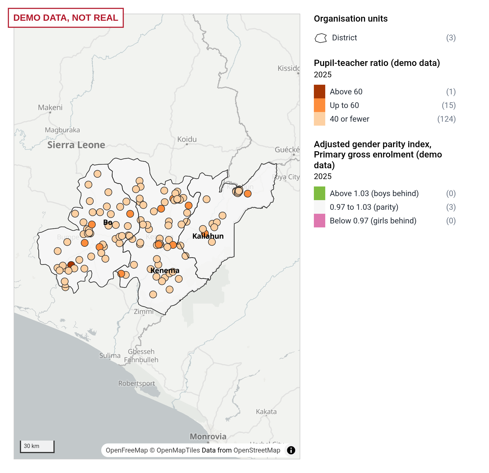
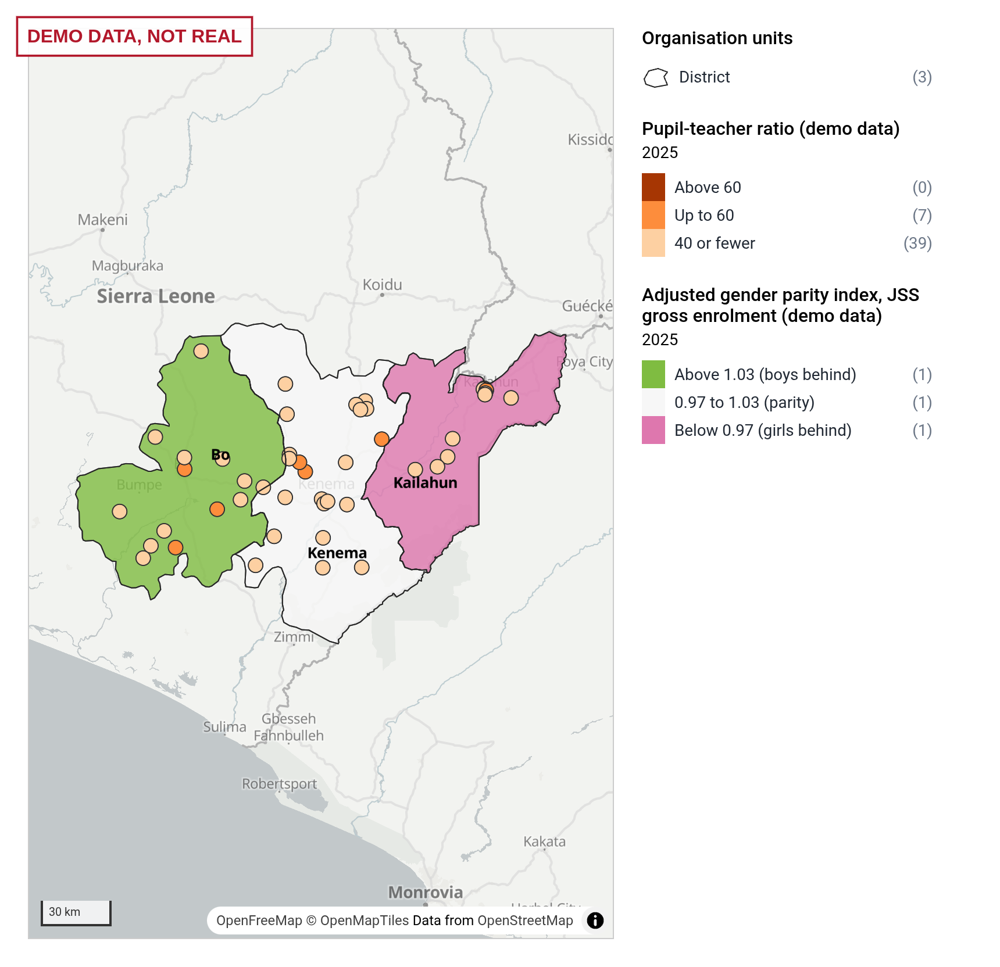
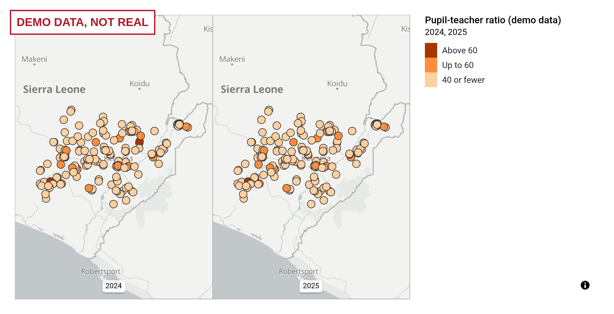
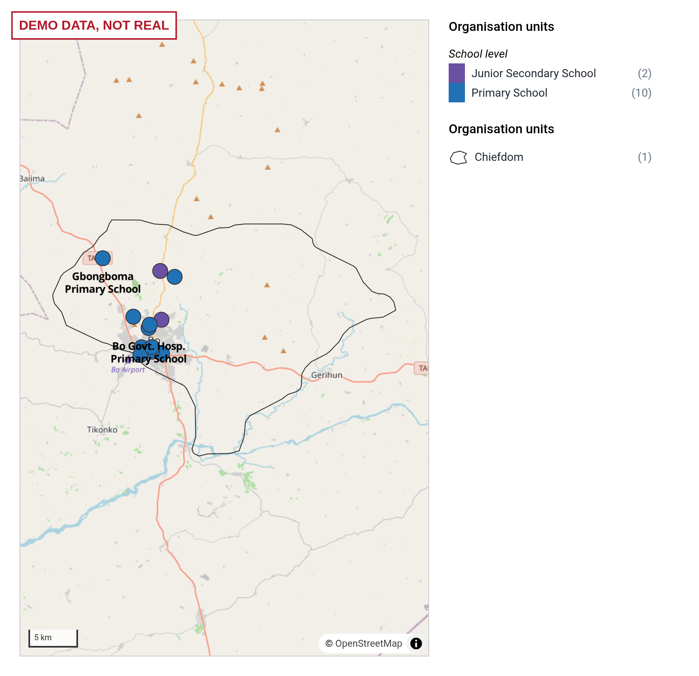

# Post 7 · Every school on the map: teacher deployment and gender parity in an EMIS

**At a glance.** Education (EMIS) · Org unit layer styled by group set with labels, school-level thematic points over a district choropleth, split view, org unit profile, data table, Download map · School census data · For education officers

**Hook.** DHIS2 is not only for health. Education ministries use the Maps app to decide where to post teachers and which schools to repair first, and a school-level map makes the case for moving teachers before hiring.

**The map.** Maps 1 and 2 show every primary and junior secondary school against its district's gender parity, Map 3 compares two census years, and Map 4 closes in on the schools of Bo town.

**Map 1 · Primary schools, 2025**

*DEMO DATA, NOT REAL.* Parity by district, pupils per teacher by school. [Open the map](https://play.im.dhis2.org/dev-2-43/dhis-web-maps/index.html#/Sn6hq48QVfp)

**Map 2 · Junior secondary, 2025**

*DEMO DATA, NOT REAL.* The same for junior secondary schools. [Open the map](https://play.im.dhis2.org/dev-2-43/dhis-web-maps/index.html#/PxyWExPhFg2)

**Map 3 · Pupil-teacher ratio, two censuses**

*DEMO DATA, NOT REAL.* Pupils per teacher by school, 2024 and 2025. [Open the map](https://play.im.dhis2.org/dev-2-43/dhis-web-maps/index.html#/fEkhomR5cWN)

**Map 4 · Schools of Bo town**

*DEMO DATA, NOT REAL.* Kakua chiefdom's schools by level. [Open the map](https://play.im.dhis2.org/dev-2-43/dhis-web-maps/index.html#/XZAVDK9tTAO)

Maps 1 and 2 each have two thematic layers for the 2025 census: the adjusted gender parity index (GPIA) by district, and the pupil-teacher ratio of each school, from peach (40 or fewer) to dark brown (above 60). Map 3 shows every school's ratio in split view. Map 4 is an org unit layer of the schools of Kakua (Bo town), styled by the "School level" group set, with name labels.

The schools are invented, each placed near a health facility of the demo database and named after its town. On the demo instance the org unit profile is not set up for schools.

**How to read it.** On Map 1, one dark brown school stands among peach ones: Ngieyehun Primary School, in Bo, at 82 pupils per teacher against a norm of 40. That points to redeployment, faster and cheaper than recruitment; a district where most schools are orange or brown needs new posts. On Map 3, Bendu Mameima Primary School, in Kenema, falls from 81 in 2024 to 36 in 2025 after teachers moved there.

Primary enrolment is at parity in all three districts (0.98 to 1.01), so Map 1's districts are near-white; click a district for its value. Parity often flips between levels, so build one map per level: on Map 2, girls are behind in Kailahun (0.84, pink) and boys in Bo (1.11, green).

**In the workflow.** Before each posting cycle, the regional education director opens the maps from the **dashboard**. **View profile** on a school opens its **org unit profile** with enrolment, teachers and classrooms, often enough to settle a posting. The school layer's **data table**, sorted by ratio, becomes the list for human resources, and **Download map** puts the maps in the census report. On the demo, the director's **interpretation** moves 6 teachers to Ngieyehun, no new posts needed.

**Domain note.** UNESCO treats a gender parity index between 0.97 and 1.03 as parity ([UNESCO Institute for Statistics fact sheet](https://webarchive.unesco.org/web/20160711133425/http://unesdoc.unesco.org/images/0023/002351/235153E.pdf)). Map the adjusted index (GPIA), which UNESCO built to be symmetrical around 1: when the girls' value is higher, GPIA = 2 − boys' value ÷ girls' value ([UIS and GEM Report, 2017](https://unesdoc.unesco.org/ark:/48223/pf0000250392)). DHIS2 indicator expressions support if(), so GPIA can be one indicator, for example if(G > B, 2 − B/G, G/B), with G and B the girls' and boys' gross enrolment ratios written out from data elements; check it in Data Visualizer before mapping. Pupil-teacher ratio norms are national: set the legend from your policy, and consider pupils per trained teacher.

**In practice.** In Togo, StatEduc collects the school census and DHIS2 turns it into dashboards, maps and tables on enrolment, teacher-pupil ratios and exam pass rates, by gender and disability. Regional education offices use it to deploy teachers, prioritise school construction and target furniture shortages ([DHIS2 for Education](https://education.dhis2.org/?p=21653)). Zambia runs its EMIS on DHIS2 ([DHIS2 user story](https://docs.dhis2.org/en/topics/user-stories/zambia-education-management-system-emis.html)), one of more than 10 countries implementing DHIS2 for Education ([implementations](https://education.dhis2.org/implementation)).

**Try it.** On the demo instance, open [Map 1](https://play.im.dhis2.org/dev-2-43/dhis-web-maps/index.html#/Sn6hq48QVfp), click the dark brown school in south-west Bo, and choose **Show data table** in the school layer's menu to sort by ratio.

On your own instance:

1. Install the [SDG4 Education Toolkit](https://docs.dhis2.org/en/implement/education/sdg4-education-toolkit/toolkit-overview.html), or use your census data sets.
2. Add schools as org units with coordinates and a "School level" group set; set up the org unit profile with enrolment, teachers, classrooms and latrines.
3. Create legend sets for the ratio (your norm and 1.5 times it) and GPIA (0.97 and 1.03), and the GPIA indicator.
4. Add layer → Thematic → GPIA → the districts → Predefined color legend → Labels. Add layer → Thematic → pupil-teacher ratio → the districts and the primary school group. Repeat for secondary.
5. New map: Thematic → pupil-teacher ratio → two census years, Split.
6. New map: Org units → a chiefdom and the schools group → Style by group set → Labels. Save all maps on a dashboard.

**Your turn.** Which school-level map do your district officers open most? Share a screenshot, and tell us how you handled schools without coordinates or census data that arrives once a year.

**En bref.** Les cartes 1 et 2 placent chaque école, colorée selon le nombre d'élèves par enseignant, sur l'indice de parité ajusté (GPIA) de son district. Une école de Bo compte 82 élèves par enseignant, contre une norme de 40 ; une école de Kenema est revenue dans la norme après un redéploiement. Les écoles et leurs chiffres sont inventés.

---

[← Post 6 · Is 100% coverage too good to be true?](06-mda-denominators.md) · [Post 8 · Seeing stockouts before patients do →](08-stockouts.md)
