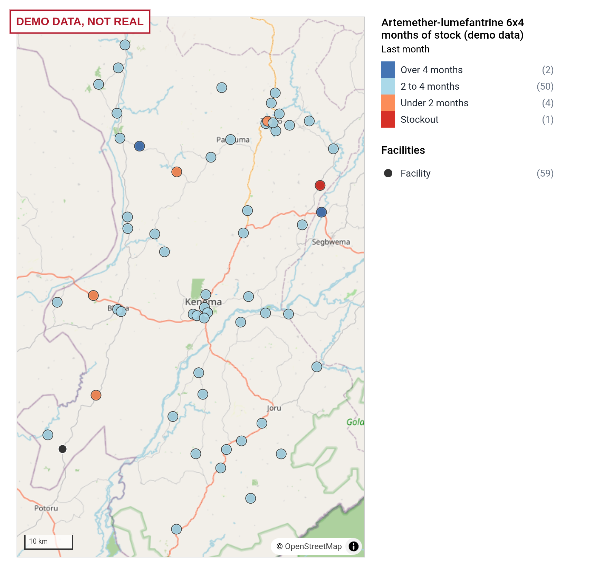
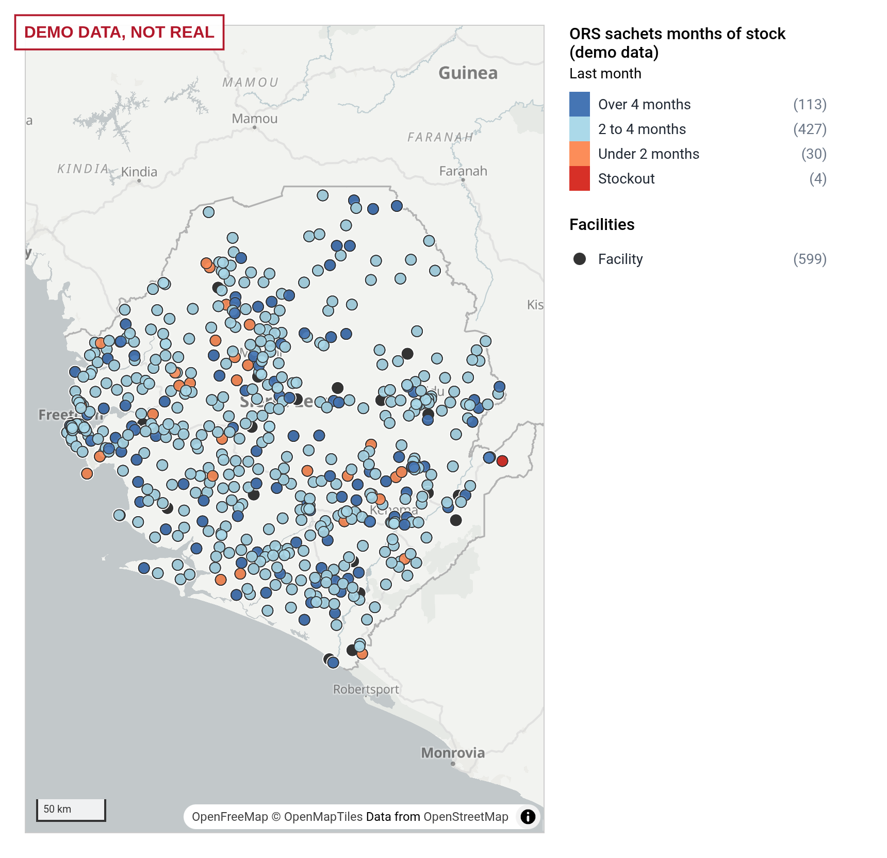

# Post 8 · Seeing stockouts before patients do: months of stock at facility level

**At a glance.** Supply chain (LMIS) · Facility-level thematic layer over a facility layer, legend sets, data table, Open in Data Visualizer app, interpretations · Stock reports · For district pharmacists and logistics officers

**Hook.** A district average of three months of stock can hide a facility with none next to one with ten. Mapping stock coverage facility by facility turns the monthly stock report into a redistribution list.

**The map.** Map 1 shows one district, where transfers are decided, for the main malaria tracer product, and Map 2 a second tracer product for the whole country.

**Map 1 · Artemether-lumefantrine in Kenema**

*DEMO DATA, NOT REAL.* Months of stock by facility, Kenema, last month. [Open the map](https://play.im.dhis2.org/dev-2-43/dhis-web-maps/index.html#/XviIPiTuExI)

**Map 2 · ORS sachets, country**

*DEMO DATA, NOT REAL.* Months of stock by facility, last month. [Open the map](https://play.im.dhis2.org/dev-2-43/dhis-web-maps/index.html#/r7nijMR9wsE)

Each map has a facility layer of every health facility as dark grey dots, the reference layer, under a thematic layer of months of stock by facility, last month: stock on hand over the reported average monthly consumption. The legend set puts a stockout in red, under 2 months in orange, 2 to 4 months in light blue and over 4 months in dark blue.

The stock reports are invented. The demo's minimum and maximum are 2 and 4 months; use your national levels. The maps merge the package's overstock and excessive stock into "Over 4 months".

**How to read it.** A dark grey dot with no coloured dot on top did not report: a data problem, not a stockout. Red and dark blue facilities close to each other are a lateral transfer waiting to happen, before an emergency order to the warehouse: on Map 1, Bendu Mameima CHC is stocked out 5 km from Massahun MCHP, which holds 9 months.

A cluster of red facilities served by the same district store points upstream to a distribution or ordering failure. In the demo, all five facilities of Yawei chiefdom, in Kailahun, are below 2 months of both products after their store missed three deliveries; on Map 2, two of them share the red dot at Kailahun town, and the other three have no coordinates.

**In the workflow.** After the monthly reporting deadline, the district pharmacist filters the **data table** to the red and dark blue facilities and agrees transfers by phone, using **Measure distances and areas** to pick the nearest overstocked facility. **Open in Data Visualizer app** on the months-of-stock layer shows whether a red facility is a one-off or has been sliding for months. An **interpretation** records the agreed transfers and @mentions the facility in-charges: on the demo, the pharmacist asks Massahun MCHP to send two months of stock to Bendu Mameima CHC this week.

**Domain note.** The DHIS2 [Monthly Stock Reporting package](https://docs.dhis2.org/en/implement/logistics/monthly-stock-reporting-msr.html) defines stock coverage time as stock on hand over average monthly demand, and groups it into stockout, understock, appropriate stock, overstock and excessive stock. Two traps matter for the map. First, if zero values are not stored, a stocked-out facility looks the same as one that never reported, as a USAID GHSC-PSM team found in Cameroon ([ASTMH poster](https://www.ghsupplychain.org/sites/default/files/2022-10/Cameroon_ASTMH_ePoster_FINAL.pdf)). Second, consumption drops during a stockout, so average consumption calculated over those months understates real demand; adjust for stockout days.

**In practice.** In Cameroon, a USAID GHSC-PSM team coached district teams to analyse malaria commodity data in DHIS2 and made stockouts distinguishable from missing reports. Logistics reporting rates rose from 70% in August 2020 to 94% in April 2021 and 95% in April 2022, and stockouts fell in both DHIS2 data and end-user verification surveys ([ASTMH poster](https://www.ghsupplychain.org/sites/default/files/2022-10/Cameroon_ASTMH_ePoster_FINAL.pdf)).

Malawi's DHIS2 logistics integration, fed by OpenLMIS, maps over- and under-stocked facilities and the distance between them to guide transfers ([DHIS2 impact story](https://dhis2.org/malawi-logistics-integration/)). In Comoros, managers use DHIS2 Real-Time Stock to coordinate redistribution; 58 of 74 sites used it within three months of go-live ([DHIS2 impact story](https://dhis2.org/?p=23433)).

**Try it.** On the demo instance, open [Map 1](https://play.im.dhis2.org/dev-2-43/dhis-web-maps/index.html#/XviIPiTuExI), click the red dot for Bendu Mameima CHC, and choose **Show data table** in the months-of-stock layer's menu to sort the facilities by value.

On your own instance:

1. In the Metadata Management app, set the stock data elements to store zero values.
2. In the System Settings app, turn on **Include zero data values in analytics tables**; without it, stocked-out facilities show as no data.
3. Report average monthly consumption as a data element and divide stock on hand by it; an indicator that averages consumption with period offsets gives wrong values in the Maps app.
4. Create a stock-status legend set from your national min and max levels.
5. Add layer → Facilities → the district. Add layer → Thematic → the months-of-stock indicator → Last month → the district, Facility level → Choropleth, Predefined color legend.
6. Save one map per tracer product on a logistics dashboard.

**Your turn.** Do your districts plan lateral transfers from facility-level stock maps, or does redistribution still go through the warehouse? Share your stock-status map, and tell us what got in the way: zeros not stored, late reports or min/max levels that differ by facility level.

**En bref.** La carte 1 montre les mois de stock d'artéméther-luméfantrine de chaque formation sanitaire du district de Kenema : Bendu Mameima CHC est en rupture à 5 km de Massahun MCHP, qui en a 9 mois, un transfert latéral évident. Un point gris sans couleur signale un rapport manquant, pas une rupture : stockez les valeurs zéro pour les distinguer. Les données de stock sont inventées ; au Cameroun, rendre les ruptures visibles dans DHIS2 a fait passer la complétude des rapports logistiques de 70 % à 95 %.

---

[← Post 7 · Every school on the map](07-schools.md) · [Post 9 · One bite, two sectors →](09-rabies-one-health.md)
