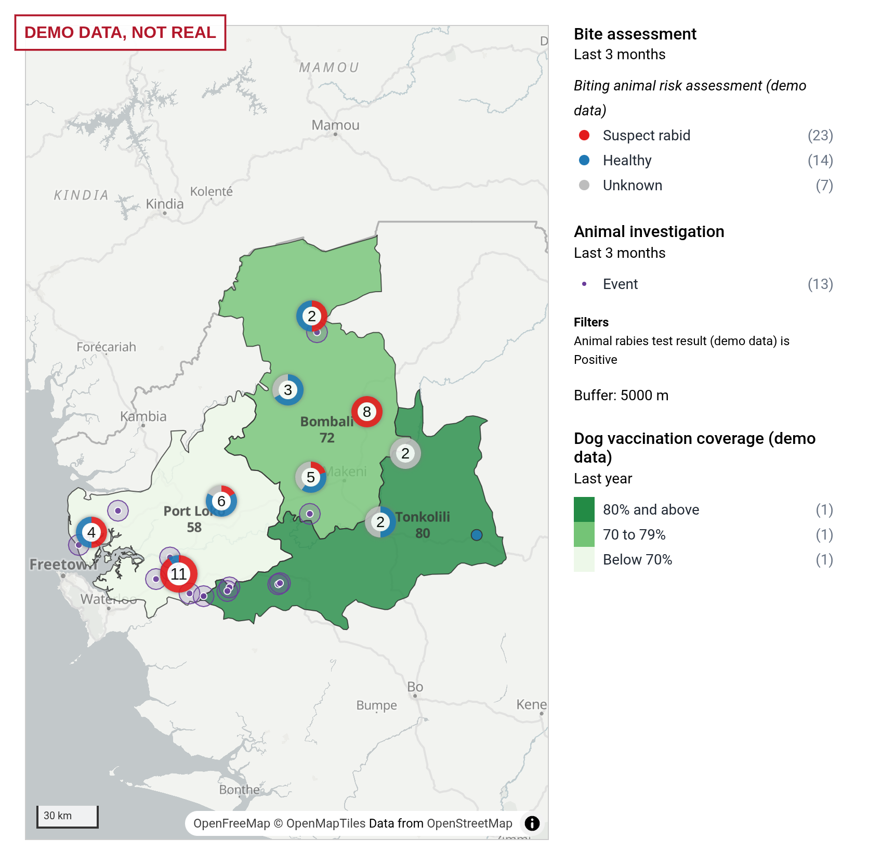
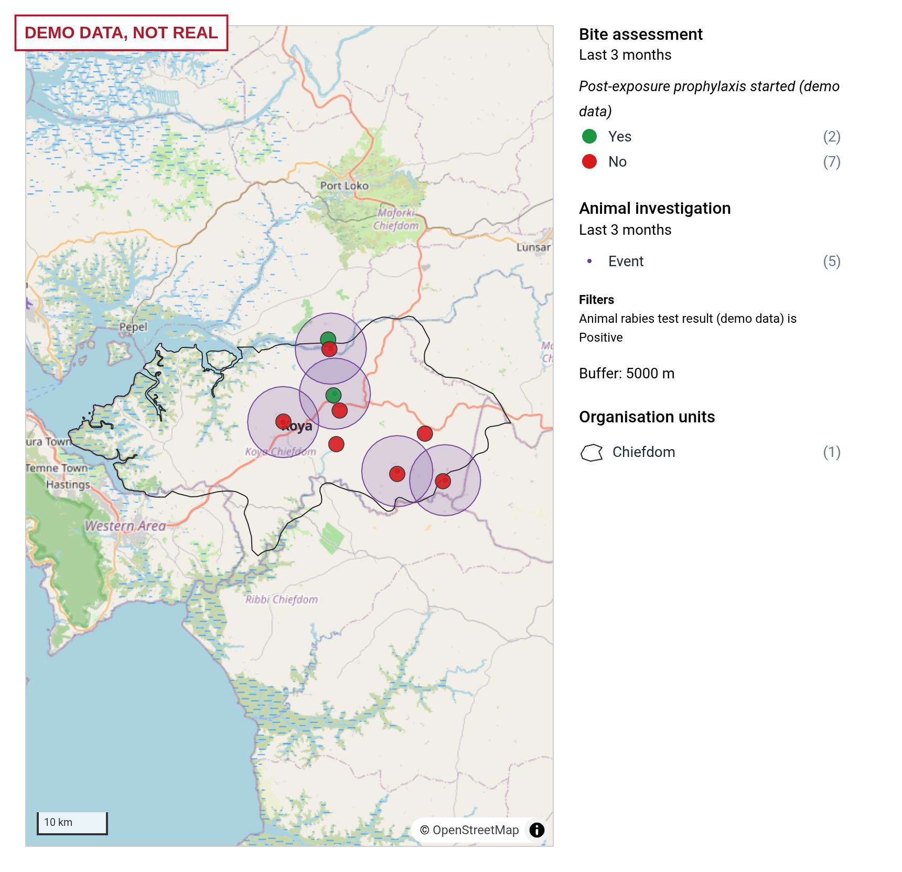

# Post 9 · One bite, two sectors: human and animal rabies data on one map

**At a glance.** One Health (rabies) · Two event layers from two programs (bites grouped by risk, rabid dogs with 5 km buffers), thematic overlay, sharing with a user group, interpretations · Case-based and aggregate data · For human and animal health officers

**Hook.** A dog bite is recorded at a health facility; the dog that bit is investigated, if at all, by a veterinary officer. When both sectors report into DHIS2, where do high-risk bites, rabid dogs and dog vaccination gaps overlap?

**The map.** The first map puts both programs over dog vaccination coverage in three districts; the second closes in on one chiefdom where people bitten have not started post-exposure prophylaxis (PEP).

**Map 1 · One bite, two sectors**

*DEMO DATA, NOT REAL.* Coverage, bites and rabid dogs, August to October 2026. [Open the map](https://play.im.dhis2.org/dev-2-43/dhis-web-maps/index.html#/MxVhv1oa0u5)

**Map 2 · Bitten, but no vaccine? Koya**

*DEMO DATA, NOT REAL.* Koya bites by PEP started, August to October 2026. [Open the map](https://play.im.dhis2.org/dev-2-43/dhis-web-maps/index.html#/iM5w0Gwkjrs)

A colour-blind friendly version of Map 2 (blue and red) is [saved as its own map](https://play.im.dhis2.org/dev-2-43/dhis-web-maps/index.html#/HfyySDmMfrA) ([image](../images/post09-3.png)).

Map 1 is a thematic layer of "Dog vaccination coverage" (dogs vaccinated ÷ estimated dog population), last year, in three districts, pale below 70%. Over it, an event layer of "Animal rabies investigation" filtered to a positive test shows rabid dogs in purple with a 5 km buffer, a radius chosen for the demo; an event layer of "Animal bite case management" groups bites into donuts by the biting animal's risk (suspect rabid in red). Both cover the last 3 months. The legends show the program stage names, not the layer names.

Map 2 shows Koya chiefdom, in Port Loko, on OSM Detailed: the same rabid dogs, and each bite styled by "Post-exposure prophylaxis started" (yes green, no red).

The bites, rabid dogs and campaign results are invented and placed in real chiefdoms.

**How to read it.** On Map 1, red donuts with no purple zone are high-risk bites where no dog was investigated, so veterinary follow-up is missing: 8 suspect rabid bites in Biriwa chiefdom, Bombali. Purple zones with no bites are rabid dogs where nobody reported a bite, so check access to post-exposure prophylaxis: 4 rabid dogs in Yoni chiefdom, Tonkolili. Both together in a pale district is the place for the next dog vaccination campaign: Port Loko, at 58%, is the only one of the 13 districts below 70%.

Map 2 shows who still needs care: in Koya, PEP started for 2 of 9 people bitten, a list of people to follow up rather than a rate.

**In the workflow.** The joint One Health committee meets every quarter. Bites and rabid dogs come from two programs run by two ministries, and the maps are **shared** with one user group, so veterinary and surveillance officers see the same One Health **dashboard**. Its **interpretations** keep the discussion with the evidence and record the decision: on the demo, Port Loko gets the next campaign and PEP stock moves to Koya.

**Domain note.** The Zero by 30 strategy to end human deaths from dog-mediated rabies by 2030 recommends Integrated Bite Case Management, where health workers assess each bite and share it with animal health officers who investigate the biting animal ([Frontiers in Tropical Diseases, 2022](https://pmc.ncbi.nlm.nih.gov/articles/PMC7614337)). In a Philippines case study, routine surveillance confirmed under 1% of circulating animal cases and IBCM increased detection fivefold ([University of Glasgow thesis, 2023](https://theses.gla.ac.uk/83692/)). WHO advises vaccinating at least 70% of the dog population in each community ([WHO](https://www.who.int/teams/control-of-neglected-tropical-diseases/rabies/vaccinations-and-immunization/veterinary-vaccines)).

The weakest number on this map is the dog population behind coverage; the demo assumes one dog for every ten people. Estimate it from household surveys or a locally measured human-to-dog ratio, and check each campaign with a post-vaccination coverage survey before trusting a dark green district.

**In practice.** Since 2019, Namibia's Directorate of Veterinary Services has recorded every dog vaccination, education event and confirmed animal rabies case in DHIS2 event programs built by GARC: more than 130,000 vaccinations in a single year, while human rabies deaths fell from 23 in 2015 to zero so far in 2026 ([DHIS2 impact story](https://dhis2.org/?p=28308)). In Cross River State, Nigeria, a DHIS2-based GARC app shows bites and rabies cases in real time ([WHO feature story](https://www.who.int/news-room/feature-stories/detail/rabies-surveillance-in-action-saving-lives-in-cross-river-state-nigeria)). In Angola, the Ministry of Agriculture and Fisheries uses DHIS2 to monitor rabies vaccination campaigns and track animal bite cases ([DHIS2 Across Sectors](https://dhis2.org/across-sectors/)).

The hard part is the data agreement: settle sharing and who sees bite locations before building the layers.

**Try it.** On the demo instance, open [Map 1](https://play.im.dhis2.org/dev-2-43/dhis-web-maps/index.html#/MxVhv1oa0u5), click a donut to zoom into its bites, and open **Interpretations and details** to read the committee's thread.

On your own instance:

1. Install DHIS2's [human rabies surveillance](https://docs.dhis2.org/en/implement/health/neglected-tropical-diseases/human-rabies-surveillance-aggregate/overview.html) and [animal health event-based surveillance](https://docs.dhis2.org/en/implement/health/animal-health/event-based-surveillance/overview.html) packages, and event programs for dog vaccinations and bites, such as the GARC rabies tools.
2. Create a legend set for dog vaccination coverage at 70%, and a user group with the health and veterinary officers.
3. Add layer → Thematic → your coverage indicator → Period: Last year → Style: Predefined color legend, your legend set.
4. Add layer → Events → the animal investigation program → Filter: test result is Positive → Style: Buffer, Radius in meters 5000.
5. Add layer → Events → the bite program → Style: Group events, Style by data item: the biting animal's risk.
6. File → Save, then File → Share with the joint user group only.

**Your turn.** Is your veterinary service reporting into the same DHIS2 instance as health, a separate one, or not at all? Share how you combined the two, and the hard parts, such as data-sharing agreements or different org unit hierarchies.

---

[← Post 8 · Seeing stockouts before patients do](08-stockouts.md) · [Post 10 · Map the data before you map the disease →](10-reporting-completeness.md)
