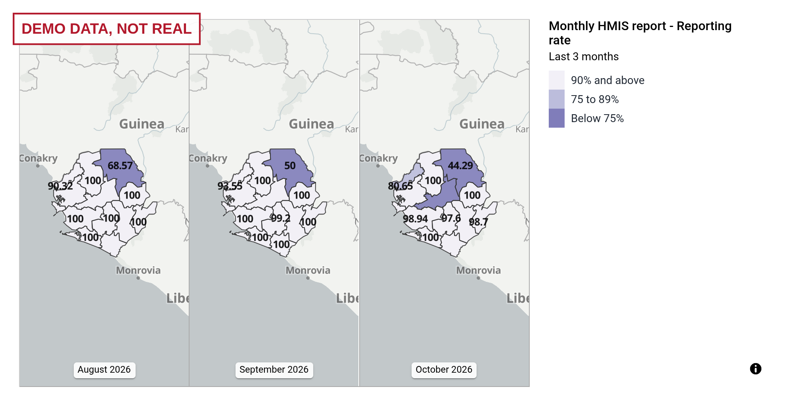
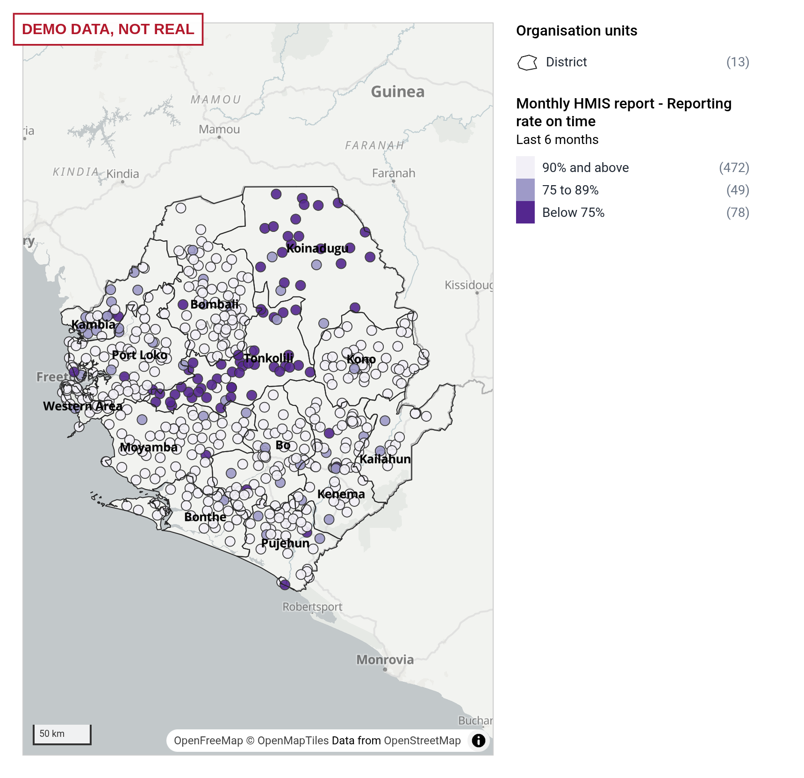
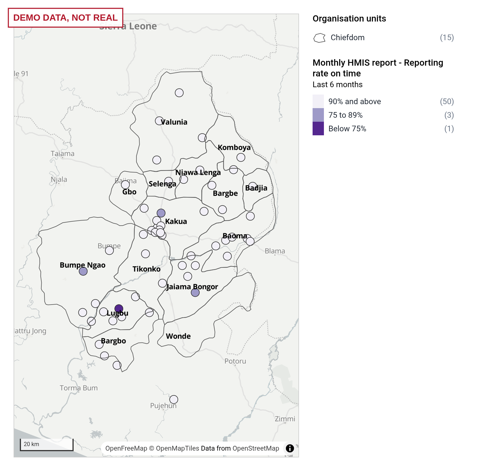

# Post 10 · Map the data before you map the disease: reporting completeness and feedback

**At a glance.** HIS and data quality · Reporting rates in a thematic layer, split view, facility-level points, interpretations with @mentions, dashboard email push, slideshow · Reporting data · For HMIS officers

**Hook.** Every map in this series assumes facilities reported, and a district with half its reports missing looks like a district with low coverage, low cases or low stock. Which districts can we trust this month?

**The map.** The maps go from districts month by month, to every facility, to the one district where a single facility falls behind.

**Map 1 · Reporting completeness, last 3 months**

*DEMO DATA, NOT REAL.* Reporting rate by district, August to October 2026. [Open the map](https://play.im.dhis2.org/dev-2-43/dhis-web-maps/index.html#/WSeomoHaTwA)

**Map 2 · Reports on time by facility**

*DEMO DATA, NOT REAL.* Reports on time by facility, May to October 2026. [Open the map](https://play.im.dhis2.org/dev-2-43/dhis-web-maps/index.html#/rhAk6xiDygg)

**Map 3 · Reports on time in Bo**

*DEMO DATA, NOT REAL.* Bo facilities on time, May to October 2026. [Open the map](https://play.im.dhis2.org/dev-2-43/dhis-web-maps/index.html#/bkq7itHMwbc)

Map 1 is a thematic layer of the "Monthly HMIS report" reporting rate by district, last 3 months, in split view: one panel per month, values as labels, the darkest purple below 75%. Koinadugu is the large district in the north-east, Tonkolili the one in the centre.

Map 2 is a thematic layer of the reporting rate on time, last 6 months, one point per facility, dark purple below 75%, with district outlines and names on top. Map 3 shows the same layer for Bo's 54 facilities, with chiefdom outlines.

The reports are invented; the facilities come from the Sierra Leone demo database.

**How to read it.** A district that stays pale on completeness while its facilities are dark on timeliness reports eventually, but too late for monthly review meetings: Tonkolili sent 97% of its reports over six recent months, but only 39% on time. A single dark facility in a pale district is a supervision visit: Ngieyehun MCHP sent 25% of its reports over 12 months, while Bo sent 99%. A whole dark district is a system problem such as connectivity, staffing or devices: Koinadugu, 61% complete. Before comparing any indicator across districts, check that both are pale here.

The latest month is still filling: late reports arrive after the panel is drawn, so Tonkolili reads 39.78 in October until they come in.

**In the workflow.** At the monthly data review meeting, the HMIS officer projects the district **dashboard** with the three maps; a dashboard map's legend can't be saved pinned, but it opens pinned in a slideshow. Late or missing facilities are named in an **interpretation** with @mentions, which notifies each in-charge; on the demo, the in-charge replies that the data clerk post has been vacant since June. Staff who rarely log in receive the dashboard by email through **dashboard email push**, the HTML push analytics job in the Scheduler app that replaced the older push analysis ([DHIS2 2.41 release note](https://dhis2.github.io/dhis2-releases/releases/2.41/ReleaseNote-2.41.html)); the demo sends it to the HMIS team on the 5th of each month once email settings are in place. Between meetings, v43's slideshow autoplay can run the dashboard in the district office. Next month, the same maps show whether the follow-up worked.

**Domain note.** Thresholds vary by country. An evaluation applying the WHO Data Quality Review toolkit used at least 75% as the acceptable level for completeness and timeliness ([Uganda SPT evaluation, 2021](https://uploads-ssl.webflow.com/61b71cb9b3bcb8b89636d4c1/61d30d996a425ab801951709_SPT%20for%20EPI%20Uganda%20evaluation%202021.pdf)), while Countdown to 2030 treats district reporting below 90% as low and suggests adjusting service counts for incomplete reporting rather than assuming non-reporting facilities provided no services ([Countdown to 2030](https://www.countdown2030.org/countdown-news/how-to-assess-the-quality-of-aggregated-routine-health-facility-data)). Put your national threshold in the legend name, as the demo's "75% and 90%" does. Timeliness depends on the data set's deadline: in the demo, 15 days after the month ends.

A reporting rate counts forms, not content: a nearly empty form still counts as complete ([DHIS2 data quality guide](https://docs.dhis2.org/ar/implement/data-quality/analysis.html)). Check data element completeness for the indicators that matter, and use the [WHO Data Quality Tool](https://docs.dhis2.org/en/use/optional-apps/who-data-quality-tool/usage-and-interpretation.html) for the consistency checks of WHO's [Data Quality Assurance toolkit](https://www.who.int/data/data-collection-tools/health-service-data/data-quality-assurance-dqa).

**In practice.** Health authorities in Balochistan, Pakistan, replaced paper reporting with DHIS2 and raised reporting compliance from 55% to 90% ([DHIS2 In Action](https://dhis2.org/in-action/)). Earlier, Uganda's national DHIS2 roll-out improved the timeliness and completeness of routine reporting from districts to the national level ([Uganda roll-out study, 2014](https://www.ncbi.nlm.nih.gov/pmc/articles/PMC4030005/)).

**Try it.** On the demo instance, open [Map 2](https://play.im.dhis2.org/dev-2-43/dhis-web-maps/index.html#/rhAk6xiDygg) and **Interpretations and details** to read the feedback thread.

On your own instance:

1. Update the Maps app from the App Hub (continuous release for DHIS2 2.40 and above), set your data set's timely submission deadline, and create a legend set with your national thresholds.
2. Add layer → Thematic → Data sets → "<data set> - Reporting rate" → Period: Last 3 months, Split → District level → Style: Predefined color legend → Labels. File → Save.
3. File → New. Add layer → Facilities.
4. Add layer → Thematic → "<data set> - Reporting rate on time" → Last 6 months → Facility level → your legend set. File → Save.
5. In **Interpretations and details**, name the late facilities and @mention the district health information officer.
6. Add both maps to the district review dashboard, and set up dashboard email push in the Scheduler app.

**Your turn.** Do your districts discuss reporting maps in monthly review meetings, and have interpretations replaced any feedback emails? Share a screenshot, and tell us where feedback stalls, such as staff without DHIS2 accounts, and what you did about it.

---

[← Post 9 · One bite, two sectors](09-rabies-one-health.md) · [Post 11 · Watching the lean season →](11-lean-season.md)
