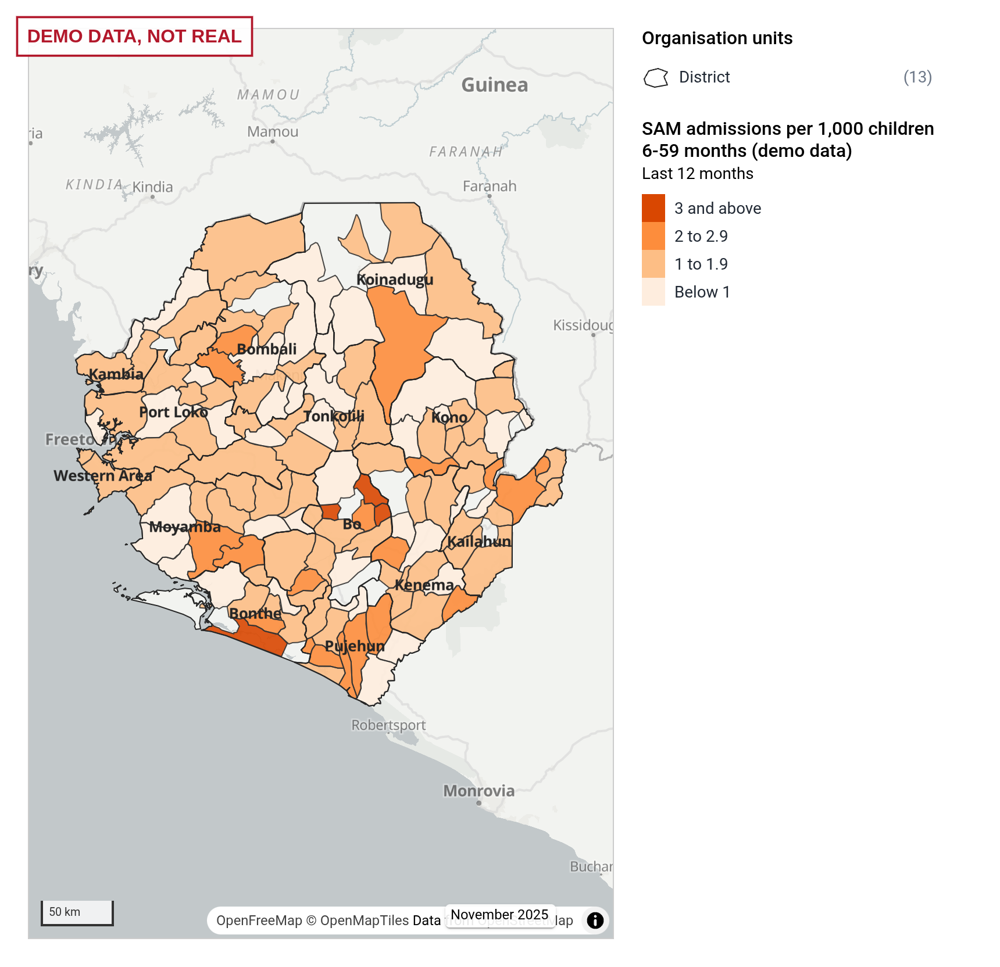
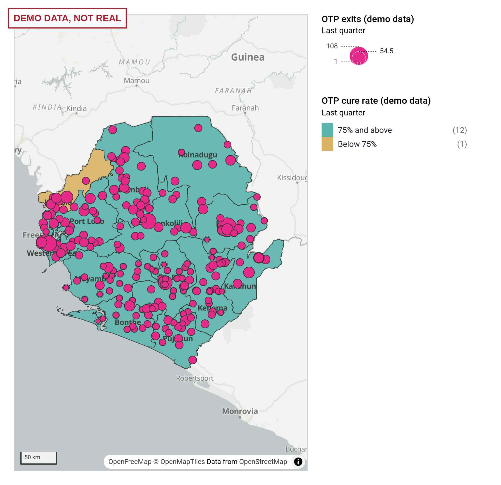
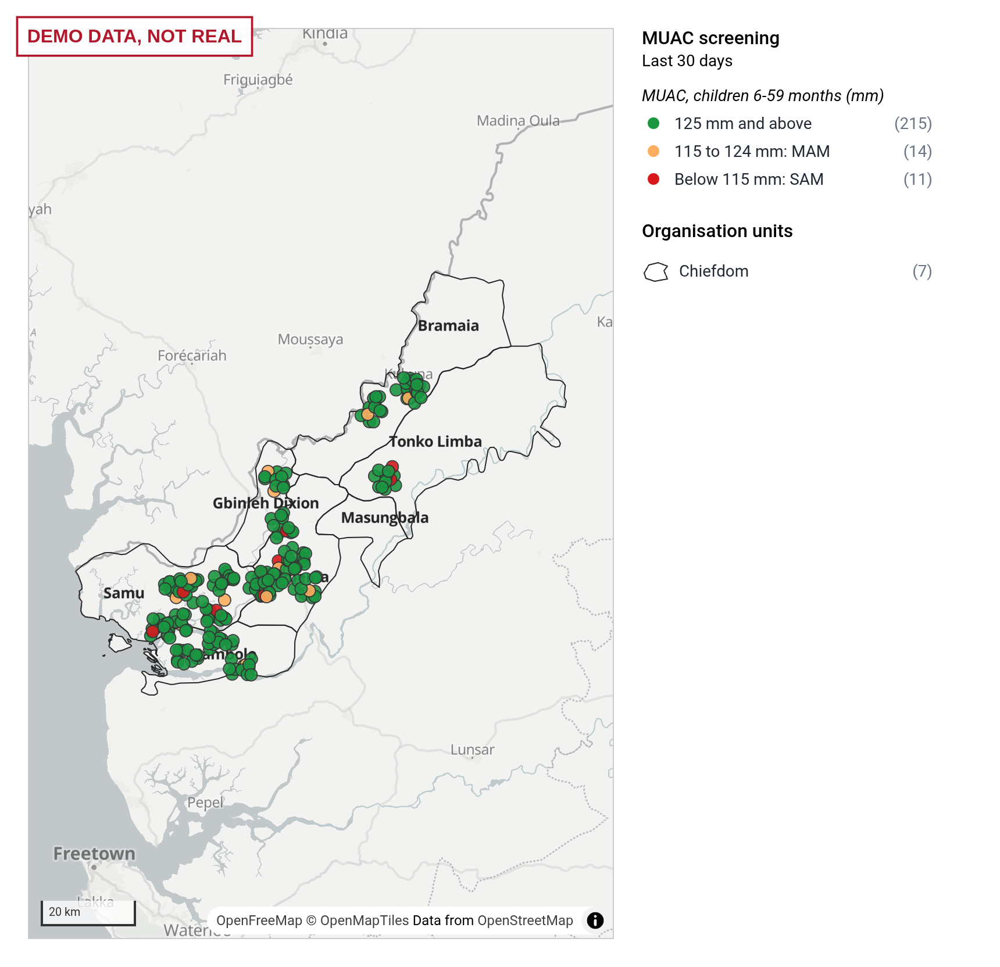

# Post 11 · Watching the lean season: malnutrition admissions on a timeline

**At a glance.** Nutrition (CMAM) · Timeline, Open in Data Visualizer app, facility-level bubbles, data table, event layer styled by a legend set, Download map · Aggregate and case-based data · For nutrition cluster coordinators

**Hook.** Acute malnutrition rises and falls with the hunger gap before harvest, and a single map cannot show a wave. Where does the wave hit first, and do treatment sites keep up?

**The map.** The timeline plays monthly admissions chiefdom by chiefdom, the second map shows whether outpatient therapeutic programme (OTP) sites keep up, and the third shows community screening in the district where they don't.

**Map 1 · SAM admissions, last 12 months**

*DEMO DATA, NOT REAL.* SAM admissions by chiefdom; image shows November 2025. [Open the map](https://play.im.dhis2.org/dev-2-43/dhis-web-maps/index.html#/JVA0jkNMz5I)

**Map 2 · OTP cure rate and exits**

*DEMO DATA, NOT REAL.* Cure rate and exits, July to September 2026. [Open the map](https://play.im.dhis2.org/dev-2-43/dhis-web-maps/index.html#/cy5BDqsrgfA)

**Map 3 · MUAC screening in Kambia**

*DEMO DATA, NOT REAL.* MUAC screening, mid-October to mid-November 2026. [Open the map](https://play.im.dhis2.org/dev-2-43/dhis-web-maps/index.html#/LPSyj6YFyyO)

A colour-blind friendly version of Map 3 (blue, orange and red) is [saved as its own map](https://play.im.dhis2.org/dev-2-43/dhis-web-maps/index.html#/T3ArAeutVl1) ([image](../images/post11-4.png)).

Map 1 is a thematic layer of "SAM admissions per 1,000 children 6-59 months" by chiefdom, last 12 months, displayed as a timeline, with district outlines on top. A legend set keeps each colour at the same rate every month. Admissions count where the OTP site is, so chiefdoms without one stay uncoloured. Download map saves the first month only: share the wave as a screen recording.

Map 2 is a thematic layer of "OTP cure rate" (cured ÷ cured, dead or defaulted) by district, last quarter, light brown below 75%, with "OTP exits" as pink bubbles for each site of the "OTP site" group. A district rate avoids percentages built on a handful of children.

Map 3 is an event layer of "Nutrition screening (MUAC)" in Kambia, last 30 days, in MUAC tape colours: red below 115 mm (SAM), orange to 124 mm, green above. The screenings are invented, at lean-season levels, around Kambia's real facilities.

**How to read it.** Map 1 shows when and where the wave starts; an early rise can mean a failed harvest, or a screening campaign that found more children. In Sierra Leone, the demo country, the lean season runs from June to August ([Cadre Harmonisé, July 2026](https://agrhymet.cilss.int/wp-content/uploads/2026/07/CH-FICHE-COMMUNICATION-JUIN-2026_english.pdf)): in the demo, admissions peak in June in Koinadugu and the north, and in August in Bo and the south.

On Map 2, a brown district with large bubbles points to RUTF stockouts (Post 8), overcrowding or late admission: Kambia, at 62%. Areas far from any bubble are candidates for new OTP sites. On Map 3, around Rokupr CHC's chiefdom, Magbema, 8% of children screened are below 115 mm, against 5% in Kambia.

**In the workflow.** The nutrition cluster meets monthly through the lean season. The coordinator plays the timeline, then uses **Open in Data Visualizer app** on the admissions layer to chart the same months for the hotspot chiefdoms, and the **data table** of the exits layer to rank sites. Map 2, saved with **Download map**, goes into the cluster bulletin, and the decision (extra RUTF, mobile teams or new OTP sites) is recorded in an **interpretation**: on the demo, the district pharmacist confirms that RUTF ran out at Rokupr CHC for several weeks.

**Domain note.** Sphere minimum standards for SAM treatment are a cure rate above 75%, deaths below 10% and defaulting below 15%, with coverage above 50% in rural areas, 70% in urban areas and 90% in camps ([ENN Harmonised Training Package](https://ennonline.net/sites/default/files/HTP-v2-module-12-technical-notes.pdf)). Coverage needs a survey such as SQUEAC or SLEAC, mapped as an annual data element beside admissions. Averages also hide geography: one programme with 50% average coverage was very high in half its site catchments and very low in the other half, and a review of 104 CMAM programmes found no urban or camp programme meeting its standard ([ENN Field Exchange](https://ennonline.net/fex/46/considerations)).

The 2023 WHO guideline on wasting, which supersedes the 2013 guidance, defines severe wasting as weight-for-height below −3 z-scores and/or MUAC below 115 mm ([commentary on the guideline, 2025](https://research.dial.uclouvain.be/bitstreams/daa232b1-7bb7-4d49-9b5f-deb1b099e082/download)) and allows trained community health workers to manage wasting ([1,000 Days summary](https://thousanddays.org/?p=14056)). When a country adopts it, add community sites to the bubble layer and mark the date with an interpretation, so falling facility admissions aren't misread as improvement.

**In practice.** In Yemen, DHIS2 Tracker supports community-based management of acute malnutrition, with an 8% reduction in severe acute malnutrition over two years and a 95% recovery rate. Egypt's Ministry of Health rolled out DHIS2 Tracker in 45 days to screen displaced Sudanese children and women for malnutrition ([DHIS2 Across Sectors](https://dhis2.org/across-sectors/)). Malawi and Uganda are building climate-informed malnutrition early warning on DHIS2 ([Malawi climate profile](https://dhis2.org/climate/country-profiles/malawi/)), which links this post to Post 12.

**Try it.** On the demo instance, open [Map 1](https://play.im.dhis2.org/dev-2-43/dhis-web-maps/index.html#/JVA0jkNMz5I) and press play on the timeline under the map.

On your own instance:

1. Install the [DHIS2 Nutrition aggregate package](https://docs.dhis2.org/en/implement/health/nutrition/nutrition-aggregate/design.html), with an indicator of SAM admissions per 1,000 children 6-59 months.
2. Create a legend set for that rate.
3. Add layer → Thematic → Indicators → your SAM admission rate → Period: Last 12 months, Timeline → your district or chiefdom level → Style: Predefined color legend, your legend set.
4. Add layer → Org units → District level → Labels.
5. File → Save, then press play.
6. Add more timeline layers to compare indicators: they share the same periods.

**Your turn.** Do you treat rising admissions as an early warning, or wait for SMART survey results before scaling up? Share your timeline, recorded, and the limits you hit, such as small numbers at OTP sites.

---

[← Post 10 · Map the data before you map the disease](10-reporting-completeness.md) · [Post 12 · Green fields, empty granaries? →](12-food-security.md)
