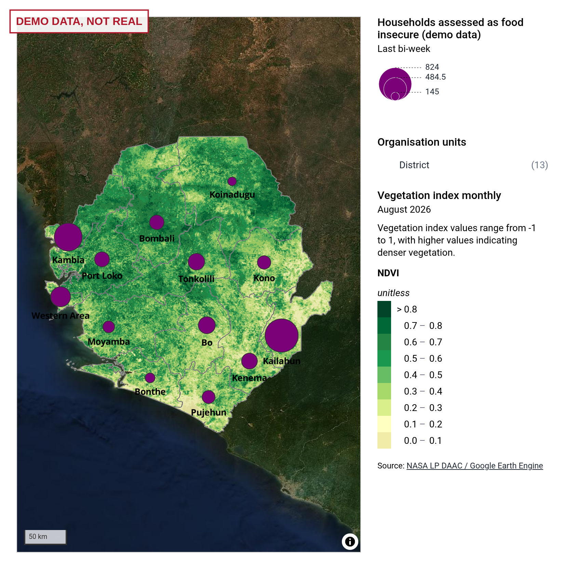
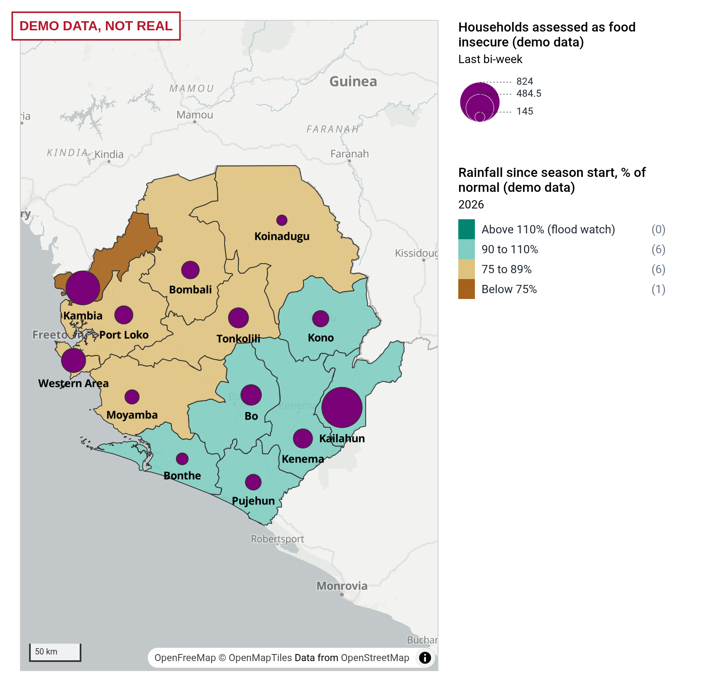
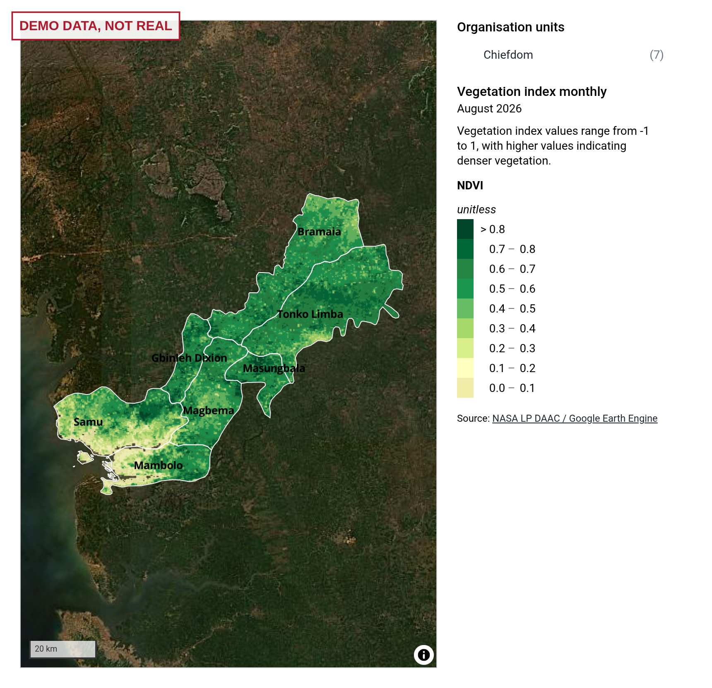

# Post 12 · Green fields, empty granaries? Vegetation, rainfall and household food security

**At a glance.** Agriculture and food security · Earth Engine vegetation for two years and landcover, rainfall against the climate normal, bubble map, data table, Download data, Download map · Household assessments and satellite data · For agriculture planners and food security analysts

**Hook.** Malawi's Ministry of Agriculture runs its national agriculture information system on DHIS2, and the Maps app puts satellite vegetation and rainfall next to household food security data. Did a dry start to the season show up in vegetation and in households?

**The map.** The first map sets this season's vegetation against food insecure households, the second gives rainfall against normal, and the third closes in on the driest district by chiefdom.

**Map 1 · Green fields, empty granaries?**

*DEMO DATA, NOT REAL.* NDVI, August 2026, and food insecure households. [Open the map](https://play.im.dhis2.org/dev-2-43/dhis-web-maps/index.html#/YBn8YxjuU8J)

**Map 2 · Rainfall against normal**

*DEMO DATA, NOT REAL.* Rainfall since April 2026, % of normal. [Open the map](https://play.im.dhis2.org/dev-2-43/dhis-web-maps/index.html#/P9QTIPGv9n4)

**Map 3 · Vegetation in Kambia**

*DEMO DATA, NOT REAL.* NDVI by chiefdom, August 2026, real satellite image. [Open the map](https://play.im.dhis2.org/dev-2-43/dhis-web-maps/index.html#/Ld5VG2I5Omr)

Map 1 has two Earth Engine layers of "Vegetation index monthly" (MODIS NDVI) by district: August 2026, and August 2024, two seasons earlier, hidden. August is a critical month in Sierra Leone, where sowing runs from April to July ([FAO GIEWS](https://www.fao.org/giews/countrybrief/country.jsp?code=SLE)); for Malawi's November to April season it would be February. A hidden Landcover layer shows where cropland lies. On top, bubbles count "Households assessed as food insecure" in the last bi-week; to compare districts of different size, map the share instead.

Map 2 is a thematic layer of "Rainfall since season start, % of normal" (CHIRPS rainfall since April over its 1991-2020 average) by district, with the same bubbles: dark brown below 75%, light teal from 90 to 110%. Map 3 shows the two vegetation layers for Kambia's chiefdoms.

Kambia's rain is set to 70% of normal for the demo; CHIRPS measured 82%. The vegetation is the real satellite image, so it need not show a drought.

**How to read it.** Start with rainfall: it is the most robust signal. A district that is dark brown on rainfall, less green than its reference year over cropland, and shows a growing food insecurity bubble is where early action belongs: targeted support, market monitoring and nutrition screening (Post 11). In the demo, Kambia's share of food insecure households rose from 12% to 37% of those assessed over the last 26 bi-weeks.

A district with normal rain and green cropland that still has a large bubble points to a non-climate cause, such as prices, pests or post-harvest losses: Kailahun, at 101% of normal rain, with 31% of assessed households food insecure.

**In the workflow.** Every two weeks, the ministry's planning unit prepares a food security bulletin. Clicking a district on each vegetation layer gives this year's and the reference year's values, and the **data table** of the bubble layer lists food insecure households by district. **Download data** exports it as GeoJSON for partners in QGIS, and **Download map** gives the bulletin's figure, once per year to compare the vegetation. The recommendations also go to the health sector: on the demo, the planner's interpretation asks the nutrition coordinator to add Kambia and Kailahun to the MUAC screening plan (Post 11).

**Domain note.** Absolute NDVI means little on its own. Early warning systems compare it with the long-term average for the same period: negative anomalies mean less vigorous vegetation ([FEWS NET eVIIRS](https://earlywarning.usgs.gov/fews/product/918)). Dry periods during flowering and grain filling can cut yields sharply ([USDA Crop Explorer](https://ipad.fas.usda.gov/cropexplorer/Definitions/spotveg.htm)). A district average mixes cropland with forest and grassland: read it as a signal to investigate, not a yield estimate.

NDVI is optical, so rainy-season cloud adds noise, as the gaps on Map 3 show; compare several months before calling a deficit. Read the map against the official classification: in West Africa, the Cadre Harmonisé projected 1.33 million people in Sierra Leone (14.7%) in Phase 3 or worse for the June to August 2026 lean season ([Cadre Harmonisé, July 2026](https://agrhymet.cilss.int/wp-content/uploads/2026/07/CH-FICHE-COMMUNICATION-JUIN-2026_english.pdf)); elsewhere it is the IPC.

**In practice.** Malawi's National Agriculture Management Information System registers more than 150,000 households, and extension officers run a bi-weekly rapid household food assessment that, with climate and production data, feeds national food security planning ([DHIS2 impact story](https://dhis2.org/malawi-climate-agriculture/)). NAMIS also takes data from the ministry's own weather stations for early warning ([DHIS2 impact story](https://dhis2.org/?p=9094); [DHIS2 Community abstract](https://community.dhis2.org/t/strengthening-agricultural-resilience-through-the-integration-of-early-warning-signals-in-the-malawi-national-agriculture-management-information-system-namis-for-climate-change-adaptation/58491)). In Nigeria, Edo State links agricultural reporting in DHIS2 to geospatial dashboards ([DHIS2 Across Sectors](https://dhis2.org/across-sectors/)); see also [DHIS2 for Agriculture](https://dhis2.org/agriculture/) on vegetation and land cover in DHIS2 maps.

**Try it.** On the demo instance, open [Map 1](https://play.im.dhis2.org/dev-2-43/dhis-web-maps/index.html#/YBn8YxjuU8J), switch on the August 2024 layer in the layer list, and click a district.

On your own instance:

1. Get MODIS vegetation indices, added by the January 2026 Maps app release ([release announcement](https://community.dhis2.org/t/maps-app-v105-5-is-now-available-new-climate-layer-sources/69377)) and standard from DHIS2 v43 ([DHIS2 v43 overview](https://dhis2.org/releases/version-43/)), with Google Earth Engine access.
2. Import monthly precipitation and its 1991-2020 normal with the Climate App ([Climate App guide](https://docs.dhis2.org/pt/implement/climate-health/climate-app-user-guide.html)), divide one by the other in an indicator, and create a legend set for it.
3. Add layer → Vegetation → Vegetation index monthly → August of this year → District level.
4. Add the same layer for August of a reference year, and hide it.
5. Add layer → Thematic → households assessed as food insecure → Last bi-week → district or extension planning area level → Bubble map. File → Save.
6. File → New: Add layer → Thematic → your rainfall indicator → this year → District level → your legend set. File → Save.

**Your turn.** Does your ministry of agriculture, or another sector, use DHIS2 maps? Share a screenshot, the decision it supports, and limits such as agriculture boundaries that differ from health districts.

---

[← Post 11 · Watching the lean season](11-lean-season.md)
